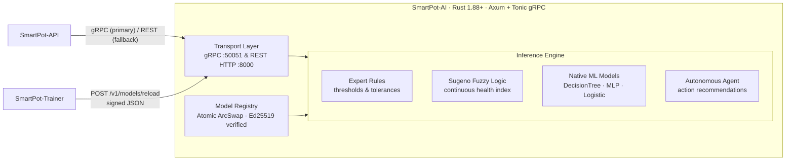

# SmartPot-AI

[English](#english) | [Español](#español)

---

<a id="english"></a>

## English

### Project Status

[](https://github.com/SmartPotTech/SmartPot-AI/actions/workflows/ci.yml)
[](https://github.com/SmartPotTech/SmartPot-AI/actions/workflows/codeql.yml)
[](https://github.com/SmartPotTech/SmartPot-AI/actions/workflows/packaging.yml)
[](https://github.com/SmartPotTech/SmartPot-AI/actions/workflows/snyk.yml)

### Description

SmartPot-AI is the **intelligent inference engine of SmartPot**, written in **Rust 1.88+** with **Axum** and **Tonic (gRPC)**: it receives the latest crop reading, historical telemetry, actuator states, placement, and outdoor weather, and returns a comprehensive diagnosis. It handles high-throughput inference; continuous model training is performed decoupled by [SmartPot-Trainer](https://github.com/SmartPotTech/SmartPot-Trainer). The legacy monolithic Python service has been archived as `SmartPot-AI-Python`.

It implements **the exact same contract** as SmartPot-AI, field by field and text by text: the API switches transparently.



| Technique | Problem Addressed | Location |
|---|---|---|
| **Expert system** | 21 forward-chaining rules (thermal stress, fungi, nutrient lockout, sensor failure, rain, trends…) | `src/engine/rules.rs`, `expert.rs` |
| **Fuzzy logic** | Health index from 0 to 100 (zero-order Sugeno, branchless trapezoids, critical worst-case rule) | `src/engine/fuzzy.rs` |
| **Forecasting** | Per-variable Theil-Sen trend estimation (median via partial selection in O(M)) and hours to threshold limit | `src/engine/forecast.rs` |
| **Base models** | Logistic regression, MLP neural network, and Isolation Forest evaluated natively | `src/engine/models.rs`, `src/ml/` |
| **Reactive agent** | Actuator action dispatch with nighttime rest enforcement from 22:00 to 06:00 | `src/engine/agent.rs` |
| **Placement advice** | Microclimate suitability evaluation and relocation advice | `src/engine/placement.rs` |
| **Fleet analysis** | Account ranking, shared issues, K-Means clustering with silhouette-optimized k, and bulk actions | `src/engine/fleet.rs`, `src/ml/kmeans.rs` |
| **Learned models** | Trainer champion models (K-Means, Isolation Forest, LoRA) with Ed25519 signing and hot reloading | `src/learning/` |

It also includes foliar VPD (Buck 1996) and a 1D Kalman filter with 3σ gating (`src/engine/vpd.rs`, `ekf.rs`) as verified utilities; they do not alter API responses to preserve strict parity.

### Parity with SmartPot-AI

Parity is validated using the Python service itself as an oracle (`tests/fixtures`, regenerable via `tools/` and `tests/regenerate.rs`):

| Test Suite | Cases | Result |
|---|---|---|
| `POST /v1/insights` | 418 requests (405 valid, 13 invalid), covering nocturnal zeros, missing sensors, history, placement, weather, and rare rules | Identical responses |
| `POST /v1/fleet` | 156 fleets from 1 to 12 crops (150 valid) | Identical responses, including clusters |
| Learned models | 40 evaluations using models trained by SmartPot-Trainer | Identical responses |
| Base models | 400 + 400 inputs tested against scikit-learn | Difference ≤ 1e-12 |

To achieve this, Rust mirrors Python operations in identical order: round-half-to-even on IEEE-754 floats, Neumaier compensated summation (`sum()`, Python 3.12+), pairwise summation (NumPy), conversion to `f32` before tree threshold comparisons (scikit-learn), and K-Means with MT19937 random generator seeded identically.

The parity fixture expected responses are regenerated in English via `SMARTPOT_REGENERATE_FIXTURES=1 cargo test --test regenerate -- --ignored` (`tests/regenerate.rs`). Run it only after a deliberate contract change and review the diff: the fleet fixtures changed when the F-08/F-22 grouping rules were corrected.

### Contract

REST server listening on port `8000` (HTTP/1.0, HTTP/1.1, and HTTP/2 without TLS). `/health` is public; all `/v1/*` routes require `Authorization: Bearer <SMARTPOT_AI_TOKEN>`, verified in constant time.

| Method | Path | Description |
|---|---|---|
| GET | `/health` | Service status (`UP`), version, learning state, and loaded learned crop species |
| POST | `/v1/insights` | Evaluates a crop reading (`InsightRequest` → `InsightResponse`) |
| POST | `/v1/fleet` | Analyzes all crops in an account (`FleetRequest` → `FleetResponse`) |
| GET | `/v1/crop-profiles`, `/v1/profiles`, `/v1/profiles/{cropType}` | Crop agronomic knowledge base by species |
| GET | `/v1/models` | Base model benchmark metrics |
| POST | `/v1/learning/reload` | Hot-reloads models trained by Trainer (`{"cropType": "LETTUCE"}` or all) |
| POST, GET, POST, DELETE, POST | `/v1/learning/readings`, `/status`, `/train`, `/crops/{cropId}`, `/prune` | Transparently proxied to SmartPot-Trainer |

Supported crop species: `LETTUCE`, `TOMATO`, `STRAWBERRY`, `BASIL`, `SPINACH`, and `PEPPER` (unrecognized species yield HTTP 422). Supported actuators: `WATER_PUMP`, `UV_LIGHT`, `FAN`, `HUMIDIFIER`, `PH_DOSER`, and `NUTRIENT_DOSER`.

**gRPC** (`proto/smartpot/v1/ai.proto`, identical to `.github/proto`): `EvaluateInsight` and `AnalyzeFleet` transmit the REST JSON payload inside `JsonBody`, preserving `0.0` (frost, nighttime) and missing sensors accurately. Listens on UNIX domain socket `AI_GRPC_SOCKET` (permissions `0666` for containers sharing the volume) and/or TCP port `GRPC_TCP_PORT`, authenticated via metadata `authorization: Bearer <token>`.

Error formats match FastAPI: 401 `{"detail": "Invalid service token"}`, 422 `{"detail": "Invalid data", "errors": [{"field", "message"}]}`, 404, and 405.

### Continual Learning

SmartPot-Trainer trains per species and outputs to the shared directory (`DATA_DIR/models`):

- `{SPECIES}_inference.json`: Champion models (scaling and parameters), K-Means, Isolation Forest, LoRA (`W = W0 + (α/r)·B·A`), and 16 control cases evaluated with scikit-learn.
- `{SPECIES}_manifest.json`: BLAKE2b hash of each file and Ed25519 signature of the canonical JSON.

Upon receiving `POST /v1/learning/reload` (called by Trainer upon completing a cycle), the service reads the bundle, verifies the manifest, and updates the active species atomically without interrupting ongoing evaluations (`ArcSwap`). When `TRUSTED_MODEL_PUBLIC_KEY_HEX` is set, only models signed by that key are accepted (closed-fail security: missing manifest, invalid signature, or hash mismatch triggers immediate rejection). Control cases are validated during reload; any model disagreeing with scikit-learn is automatically disabled.

**Hardening (November 2026).** Reload now requires exactly 16 finite control cases with 10 features and at least one expectation per trained model; a manifest larger than 1 MiB is rejected before it is read. `POST /v1/learning/reload` returns `400` with the `rejected` detail even for a global reload, and `POST /v1/learning/readings` returns `503` instead of silently reporting `stored: 0` when the Trainer is unavailable. The reactive agent blocks `UV_LIGHT ACTIVATE` whenever `resting` is true, `Some(0.0)` pH corrections never dose, and `localHour` is derived from `measuredAt` with `AI_TIMEZONE` when the request omits it.

When `SMARTPOT_TRAINER_URL` is unset, learning routes return a safe disabled state. If the Trainer is unresponsive, ingestion, forget, and prune endpoints return an empty success response rather than tripping the API circuit breaker; inference never depends on Trainer availability.

### Environment Variables

| Variable | Default | Purpose |
|---|---|---|
| `SMARTPOT_AI_TOKEN` | — | Service token (minimum 24 characters). Required |
| `PORT` | `8000` | REST HTTP port |
| `AI_GRPC_SOCKET` (or `GRPC_UDS_PATH`) | empty | gRPC UNIX domain socket path |
| `GRPC_TCP_PORT` | `0` | gRPC TCP port (0 disables TCP) |
| `SMARTPOT_TRAINER_URL` | empty | SmartPot-Trainer service base URL |
| `SMARTPOT_TRAINER_TOKEN` | `SMARTPOT_AI_TOKEN` | Bearer token for calling Trainer |
| `DATA_DIR` | `data` | Shared data directory; models are loaded from `DATA_DIR/models` |
| `TRUSTED_MODEL_PUBLIC_KEY_HEX` | empty | Ed25519 public key of SmartPot-Trainer for model verification |
| `AI_TIMEZONE` | `America/Bogota` | IANA zone used to derive `localHour` from `measuredAt` |
| `LEARNING_MIN_SAMPLES` | `200` | Sample threshold for first training, used in advisory messages |
| `RUST_LOG` | `info` | Tracing and logging filter |

### One-Command Deployment

The container image is published at `ghcr.io/smartpottech/smartpot-ia-rust`. The complete `demo-beta` stack can be launched without cloning the source code:

```bash
curl -fsSL https://raw.githubusercontent.com/SmartPotTech/.github/main/docker/demo-beta/compose.yaml | docker compose -f - up -d --wait
```

Open http://localhost:5173 and log in with `demo@smartpot.app` / `SmartPot2026`. Stop with `docker compose -p smartpot-demo-beta down`. Further details in the [demo-beta documentation](https://github.com/SmartPotTech/.github/tree/main/docker/demo-beta).

### Development and Testing

Prerequisites: Rust 1.88+ (built-in protobuf compilation via protox; external `protoc` not required).

```bash
cp .env.example .env    # configure SMARTPOT_AI_TOKEN
cargo fmt --all -- --check
cargo clippy --all-targets -- -D warnings
cargo test
cargo run --release
```

The test suite covers agronomic profiles, fuzzy logic, Theil-Sen forecasting, expert rules, nighttime rest agent rules, K-Means clustering, LoRA adapters, VPD calculations, 1D Kalman filtering, Ed25519 signatures, BLAKE2b digests, REST API endpoints, gRPC via TCP and UNIX socket, Trainer reverse proxy, and parity with Python.

#### Regenerating Parity Fixtures and Base Models

With sibling repositories present:

```bash
uv run --project ../SmartPot-AI python tools/export_base_models.py ../SmartPot-AI
uv run --project ../SmartPot-AI python tools/generate_parity_fixtures.py ../SmartPot-AI
uv run --project ../SmartPot-Trainer python tools/generate_learned_fixtures.py train ../SmartPot-Trainer
SMARTPOT_REGENERATE_FIXTURES=1 cargo test --test regenerate -- --ignored
```

`models/base_models.json` is embedded directly in the compiled binary: base models initialize at startup in milliseconds without disk I/O.

#### Docker Image

```bash
docker build -t smartpot-ia-rust .
docker pull ghcr.io/smartpottech/smartpot-ia-rust:latest
```

Multi-stage build based on `rust:1.98-bookworm` and `debian:bookworm-slim`, running under unprivileged user `10001`. Supports `read_only: true`, `cap_drop: ALL`, and `no-new-privileges: true`. Health checks use the binary itself (`smartpot-ia --healthcheck`), eliminating `curl` dependencies.

### Documentation

[`docs/SmartPot_IA_Rust_Documentation.md`](docs/SmartPot_IA_Rust_Documentation.md) details internal architecture, inference reasoning pipelines, numeric parity details, and continual learning lifecycles, with diagrams in [`docs/diagrams`](docs/diagrams).

The [interactive diagrams](docs/diagrams/interactive/README.md#english) show the REST and gRPC transports, the service token and the model registry, in English and Spanish, with links to the exact source lines.

### License

This project is licensed under the MIT License. See [LICENSE](LICENSE) for details.

---

<a id="español"></a>

## Español

### Estado del Proyecto

[](https://github.com/SmartPotTech/SmartPot-AI/actions/workflows/ci.yml)
[](https://github.com/SmartPotTech/SmartPot-AI/actions/workflows/codeql.yml)
[](https://github.com/SmartPotTech/SmartPot-AI/actions/workflows/packaging.yml)
[](https://github.com/SmartPotTech/SmartPot-AI/actions/workflows/snyk.yml)

### Descripción

SmartPot-AI es el **motor inteligente de inferencia y diagnóstico agronómico** en producción de SmartPot: recibe la última lectura
de un cultivo, su historial, los actuadores, el lugar y el clima de afuera, y devuelve el diagnóstico agronómico completo. Es el servicio
de inferencia; el reentrenamiento y aprendizaje continuo lo ejecuta [SmartPot-Trainer](https://github.com/SmartPotTech/SmartPot-Trainer).
La implementación histórica en Python se conserva archivada en [SmartPot-AI-Python](https://github.com/SmartPotTech/SmartPot-AI-Python).

Mantiene **paridad estricta** con el contrato de la plataforma, campo por campo y texto por texto: la API consume sus endpoints de manera transparente.


| Técnica | Qué resuelve | Dónde vive |
|---|---|---|
| **Sistema experto** | 21 reglas con encadenamiento hacia adelante (estrés térmico, hongos, bloqueo de nutrientes, falla de sensor, lluvia, tendencia…) | `src/engine/rules.rs`, `expert.rs` |
| **Lógica difusa** | Índice de salud de 0 a 100 (Sugeno de orden cero, trapecios sin ramas, peor caso crítico) | `src/engine/fuzzy.rs` |
| **Pronóstico** | Tendencia por variable con Theil-Sen (mediana por selección parcial en O(M)) y horas hasta el límite | `src/engine/forecast.rs` |
| **Modelos base** | Regresión logística, red MLP e Isolation Forest evaluados de forma nativa en Rust | `src/engine/models.rs`, `src/ml/` |
| **Agente reactivo** | Acciones sobre los actuadores del cultivo; respeta el descanso nocturno de 22:00 a 6:00 | `src/engine/agent.rs` |
| **Consejo de lugar** | Si el lugar le sirve a la especie y cuándo conviene moverla | `src/engine/placement.rs` |
| **Análisis de flota** | Ranking, problemas compartidos, grupos K-Means con k por silueta y acciones en bloque | `src/engine/fleet.rs`, `src/ml/kmeans.rs` |
| **Lo aprendido** | Modelos del Trainer (campeones, K-Means, Isolation Forest, LoRA) con firma Ed25519 y recarga en caliente | `src/learning/` |

También trae el VPD foliar (Buck 1996) y un filtro de Kalman 1D con compuerta de 3σ (`src/engine/vpd.rs`,
`ekf.rs`) como utilidades probadas; no cambian la respuesta, para mantener estricta paridad.

### Paridad con la Implementación Histórica Python

La paridad se comprobó con el oráculo en Python (`tests/fixtures`, regenerables con `tools/` y `tests/regenerate.rs`):

| Prueba | Casos | Resultado |
|---|---|---|
| `POST /v1/insights` | 418 peticiones (405 válidas y 13 inválidas), con ceros nocturnos, sensores ausentes, historial, lugar, clima y reglas poco frecuentes | Mismas respuestas |
| `POST /v1/fleet` | 156 flotas de 1 a 12 cultivos (150 válidas) | Mismas respuestas, grupos incluidos |
| Lo aprendido | 40 evaluaciones con modelos que entrenó el Trainer | Mismas respuestas |
| Modelos base | 400 + 400 entradas contra scikit-learn | Diferencia ≤ 1e-12 |

Para lograrlo, Rust repite las operaciones de Python en el mismo orden: `round` con mitad al par, la suma compensada
de `sum()` (Python 3.12+), la suma por pares de NumPy, la conversión a `f32` de los árboles de scikit-learn y, en la
flota, el K-Means de scikit-learn con su generador MT19937 y la misma semilla.

Los casos de paridad se regeneran en inglés mediante `SMARTPOT_REGENERATE_FIXTURES=1 cargo test --test regenerate -- --ignored` (`tests/regenerate.rs`). Úsalo solo tras un cambio deliberado del contrato y revisa el diff: los fixtures de flota cambiaron al corregir las reglas de agrupación F-08/F-22.

### Contrato

REST en el puerto `8000` (HTTP/1.0, HTTP/1.1 y HTTP/2 sin TLS). `/health` es público; todo `/v1/*` exige
`Authorization: Bearer <SMARTPOT_AI_TOKEN>`, comparado en tiempo constante.

| Método | Ruta | Qué hace |
|---|---|---|
| GET | `/health` | Estado (`UP`), versión, aprendizaje y especies con modelos aprendidos |
| POST | `/v1/insights` | Evalúa una lectura (`InsightRequest` → `InsightResponse`) |
| POST | `/v1/fleet` | Analiza los cultivos de una cuenta (`FleetRequest` → `FleetResponse`) |
| GET | `/v1/crop-profiles`, `/v1/profiles`, `/v1/profiles/{cropType}` | Base de conocimiento por especie |
| GET | `/v1/models` | Exactitud de los modelos base |
| POST | `/v1/learning/reload` | Recarga en caliente los modelos del Trainer (`{"cropType": "LETTUCE"}` o todos) |
| POST, GET, POST, DELETE, POST | `/v1/learning/readings`, `/status`, `/train`, `/crops/{cropId}`, `/prune` | Se reenvían tal cual a SmartPot-Trainer |

Especies: `LETTUCE`, `TOMATO`, `STRAWBERRY`, `BASIL`, `SPINACH` y `PEPPER` (otra especie responde 422). Actuadores: `WATER_PUMP`, `UV_LIGHT`, `FAN`, `HUMIDIFIER`, `PH_DOSER` y `NUTRIENT_DOSER`.

**gRPC** (`proto/smartpot/v1/ai.proto`, el mismo de `.github/proto`): `EvaluateInsight` y `AnalyzeFleet` llevan el
JSON de REST en `JsonBody`, así un `0.0` (helada, noche) llega como `0.0` y un sensor ausente como ausente, y la
respuesta es la de REST byte a byte. Escucha en el socket UNIX `AI_GRPC_SOCKET` (permisos 0666 para los contenedores
que comparten el volumen) y/o en TCP `GRPC_TCP_PORT`, con el metadato `authorization: Bearer <token>`.

Errores estandarizados en formato FastAPI: 401 `{"detail": "Invalid service token"}`, 422
`{"detail": "Invalid data", "errors": [{"field", "message"}]}`, 404 y 405.

### Aprendizaje continuo

SmartPot-Trainer entrena por especie y escribe en la carpeta compartida (`DATA_DIR/models`):

- `{ESPECIE}_inference.json`: los campeones (escalado y parámetros), K-Means, Isolation Forest, LoRA
  (`W = W0 + (α/r)·B·A`) y 16 casos de control evaluados con scikit-learn.
- `{ESPECIE}_manifest.json`: hash BLAKE2b de cada archivo y firma Ed25519 del JSON canónico.

Al recibir `POST /v1/learning/reload` (lo llama el Trainer al terminar), la IA lee el archivo, verifica el manifiesto y
cambia la especie de una vez, sin pausar evaluaciones (`ArcSwap`). Con `TRUSTED_MODEL_PUBLIC_KEY_HEX` solo acepta lo
firmado con esa clave (falla cerrada: sin manifiesto, con otra firma o con otro hash, rechaza). Al cargar evalúa los
casos de control: un modelo que no da lo mismo que en Python se deshabilita.

**Endurecimiento (noviembre de 2026).** La recarga exige exactamente 16 casos de control finitos con 10 features y al menos una expectativa por modelo entrenado; un manifiesto de más de 1 MiB se rechaza antes de leerlo. `POST /v1/learning/reload` devuelve `400` con el detalle de `rejected` incluso en una recarga global, y `POST /v1/learning/readings` devuelve `503` en lugar de informar `stored: 0` en silencio cuando el Trainer no está disponible. El agente reactivo bloquea `UV_LIGHT ACTIVATE` si `resting` es verdadero, una corrección de pH `Some(0.0)` nunca dosifica, y `localHour` se deriva de `measuredAt` con `AI_TIMEZONE` cuando falta en la petición.

Sin `SMARTPOT_TRAINER_URL`, las rutas de aprendizaje responden un estado deshabilitado seguro. Si el Trainer no
responde, `POST /v1/learning/readings` devuelve `503` para que la API reencole el lote y no se pierdan lecturas en
silencio; olvido y poda conservan su contrato. Esto evita abrir el circuit breaker de
la API; la evaluación nunca depende del Trainer.

### Variables de entorno

| Variable | Por defecto | Uso |
|---|---|---|
| `SMARTPOT_AI_TOKEN` | — | Token de servicio (mínimo 24 caracteres). Obligatorio |
| `PORT` | `8000` | Puerto REST |
| `AI_GRPC_SOCKET` (o `GRPC_UDS_PATH`) | vacío | Socket UNIX de gRPC |
| `GRPC_TCP_PORT` | `0` | Puerto TCP de gRPC (0 lo apaga) |
| `SMARTPOT_TRAINER_URL` | vacío | URL de SmartPot-Trainer |
| `SMARTPOT_TRAINER_TOKEN` | `SMARTPOT_AI_TOKEN` | Token para llamar al Trainer |
| `DATA_DIR` | `data` | Carpeta compartida; los modelos se leen de `DATA_DIR/models` (vacío = sin modelos) |
| `TRUSTED_MODEL_PUBLIC_KEY_HEX` | vacío | Clave pública Ed25519 del Trainer |
| `AI_TIMEZONE` | `America/Bogota` | Zona IANA para derivar `localHour` desde `measuredAt` |
| `LEARNING_MIN_SAMPLES` | `200` | Lecturas del primer entrenamiento, para el mensaje mientras el Trainer no informa |
| `RUST_LOG` | `info` | Nivel de registro |

### Despliegue en un comando

La imagen es pública: `ghcr.io/smartpottech/smartpot-ai`. El entorno de demostración se levanta sin descargar el código fuente:

```bash
curl -fsSL https://raw.githubusercontent.com/SmartPotTech/.github/main/docker/demo/compose.yaml | docker compose -f - up -d --wait
```

Abre http://localhost:5173 e ingresa con `demo@smartpot.app` / `SmartPot2026`. Se detiene con
`docker compose -p smartpot-demo down`. Más detalle en la
[demo local](https://github.com/SmartPotTech/.github/tree/main/docker/demo).

### Desarrollo y pruebas

Requisitos: Rust 1.88 o superior (no hace falta `protoc`: el contrato se compila con protox).

```bash
cp .env.example .env    # define SMARTPOT_AI_TOKEN
cargo fmt --all -- --check
cargo clippy --all-targets -- -D warnings
cargo test
cargo run --release
```

Las pruebas cubren perfiles, lógica difusa, Theil-Sen, reglas, descanso nocturno del agente, K-Means, LoRA, VPD, el
filtro de Kalman, la firma Ed25519 y el hash BLAKE2b, REST, gRPC por TCP y por socket UNIX, el proxy al Trainer y la
paridad con Python.

#### Regenerar los casos de paridad y los modelos base

Con los repositorios clonados uno junto al otro:

```bash
uv run --project ../SmartPot-AI-Python python tools/export_base_models.py ../SmartPot-AI-Python
uv run --project ../SmartPot-AI-Python python tools/generate_parity_fixtures.py ../SmartPot-AI-Python
uv run --project ../SmartPot-Trainer python tools/generate_learned_fixtures.py train ../SmartPot-Trainer
SMARTPOT_REGENERATE_FIXTURES=1 cargo test --test regenerate -- --ignored
```

`models/base_models.json` queda dentro del binario: los modelos base cargan al arrancar en unos milisegundos, sin
entrenar.

#### Imagen Docker

```bash
docker build -t smartpot-ai .
docker pull ghcr.io/smartpottech/smartpot-ai:latest
```

Compilación en `rust:1.98-bookworm` y ejecución en `debian:bookworm-slim` actualizado, con el usuario sin privilegios
`10001`. Admite `read_only: true`, `cap_drop: ALL` y `no-new-privileges:true`; la sonda de salud es el propio binario
(`smartpot-ai --healthcheck`), sin `curl`. Cada cambio en `main` pasa por el CI y publica la imagen en GHCR (y en
Docker Hub si el repositorio tiene credenciales).

### Documentación

[`docs/SmartPot_IA_Rust_Documentation.md`](docs/SmartPot_IA_Rust_Documentation.md) explica la arquitectura, cómo razona
una evaluación, la paridad numérica y el ciclo de los modelos aprendidos, con sus diagramas en
[`docs/diagrams`](docs/diagrams).

Los [diagramas interactivos](docs/diagrams/interactive/README.md#español) muestran los transportes REST y gRPC, el token de servicio y el registro de modelos, en español e inglés, con enlaces a las líneas exactas del código.

### Licencia

Este proyecto está bajo la licencia MIT. Consulta el archivo [LICENSE](LICENSE) para más detalles.
