<!-- portada
eyebrow: Documentación del componente
titulo: SmartPot-IA-Rust
acento: IA-Rust
subtitulo: La inferencia del asistente inteligente de SmartPot en Rust
bajada: Sistema experto, lógica difusa, pronóstico, modelos, agente, consejo de lugar y análisis de flota con el mismo contrato que SmartPot-AI, por REST y gRPC, y los modelos aprendidos por SmartPot-Trainer con firma y recarga en caliente.
documento: SmartPot-IA-Rust
version: 1.0 · noviembre 2026
equipo: SmartPotTech
proyecto: smartpot.app
-->

# SmartPot-IA-Rust

## Ficha del documento

| Campo | Valor |
| --- | --- |
| Proyecto | SmartPot · [smartpot.app](https://smartpot.app) |
| Componente | [SmartPot-IA-Rust](https://github.com/SmartPotTech/SmartPot-IA-Rust) |
| Versión | 1.0.0 · noviembre 2026 |
| Lenguaje y runtime | Rust 1.88+ (edición 2021) · Tokio · Axum 0.8 · Tonic 0.14 · sin `unsafe` |
| Alcance | Arquitectura, cómo razona una evaluación, paridad con SmartPot-AI, modelos base y aprendidos, contrato REST y gRPC, seguridad, pruebas y operación |
| Estado | Stack nuevo (`demo-beta`); el stack actual sigue con SmartPot-AI en Python |

---

## 1. Propósito

### En palabras simples

SmartPot-IA-Rust es la parte que **piensa** en el stack nuevo: la API le manda la lectura de un cultivo y la IA le
devuelve cómo está la planta, qué la afecta, qué va a pasar en las próximas horas y qué hacer. No entrena: usa los
modelos que entrena [SmartPot-Trainer](https://github.com/SmartPotTech/SmartPot-Trainer) y los modelos base que vienen
dentro del binario.

Reemplaza a [SmartPot-AI](https://github.com/SmartPotTech/SmartPot-AI) en el stack nuevo sin que la API ni la PWA
noten la diferencia: mismas rutas, mismos campos, mismos códigos y mismos textos en español. SmartPot-AI queda
congelado para el stack actual (producción, `demo` y `dev`) hasta su retiro.

| Pieza | Stack actual | Stack nuevo |
| --- | --- | --- |
| Inferencia | SmartPot-AI (Python, FastAPI, scikit-learn) | **SmartPot-IA-Rust** |
| Entrenamiento | Dentro de SmartPot-AI (SQLite) | SmartPot-Trainer (Python) |
| Transporte con la API | REST | REST o gRPC (socket UNIX o TCP) |
| Modelos aprendidos | `joblib` (pickle) | JSON nativo firmado con Ed25519 |

## 2. Arquitectura

```mermaid
%%{init: {"theme": "base", "fontFamily": "Segoe UI, Arial, sans-serif", "themeVariables": {"fontFamily": "Segoe UI, Arial, sans-serif", "fontSize": "15px", "primaryColor": "#DDF5EA", "primaryTextColor": "#17261F", "primaryBorderColor": "#067A52", "secondaryColor": "#E3F2FB", "secondaryTextColor": "#17261F", "secondaryBorderColor": "#1F6FA0", "tertiaryColor": "#F2F7F4", "tertiaryTextColor": "#17261F", "tertiaryBorderColor": "#D5E3DC", "lineColor": "#5B6B63", "textColor": "#17261F", "mainBkg": "#DDF5EA", "nodeBorder": "#067A52", "clusterBkg": "#F7FAF8", "clusterBorder": "#D5E3DC", "edgeLabelBackground": "#FFFFFF", "actorBkg": "#067A52", "actorBorder": "#0B3D2B", "actorTextColor": "#FFFFFF", "actorLineColor": "#5B6B63", "signalColor": "#17261F", "signalTextColor": "#17261F", "labelBoxBkgColor": "#0B3D2B", "labelBoxBorderColor": "#0B3D2B", "labelTextColor": "#FFFFFF", "loopTextColor": "#0B3D2B", "noteBkgColor": "#FDF4DD", "noteBorderColor": "#C98D12", "noteTextColor": "#17261F", "activationBkgColor": "#DDF5EA", "activationBorderColor": "#067A52", "attributeBackgroundColorOdd": "#FFFFFF", "attributeBackgroundColorEven": "#F2F7F4"}, "layout": "elk", "elk": {"nodePlacementStrategy": "BRANDES_KOEPF", "mergeEdges": false, "cycleBreakingStrategy": "GREEDY"}}}%%
flowchart LR
  api["SmartPot-API-Go<br/>cliente de la IA"]
  trainer["SmartPot-Trainer<br/>entrenamiento en Python"]
  shared[("Volumen compartido<br/>DATA_DIR/models")]
  subgraph ia["SmartPot-IA-Rust · Rust 1.88+ / Tokio"]
    direction TB
    rest["http.rs · Axum :8000<br/>REST, token en tiempo constante"]
    grpc["grpc.rs · Tonic<br/>socket UNIX y TCP, mismo JSON"]
    services["services · insights y flota<br/>validación del contrato"]
    engine["engine · diagnóstico, difusa, Theil-Sen,<br/>21 reglas, agente, lugar, flota"]
    base["engine/models.rs<br/>modelos base dentro del binario"]
    learned["learning · registro ArcSwap<br/>Ed25519 + BLAKE2b + casos de control"]
    proxy["learning/trainer.rs<br/>proxy y conteos con caché"]
  end
  api -->|"REST HTTP/1.x"| rest
  api -->|"gRPC HTTP/2"| grpc
  rest & grpc --> services
  services --> engine
  engine --> base
  services --> learned
  rest -->|"/v1/learning/*"| proxy
  proxy -->|"HTTP + token"| trainer
  trainer -->|"escribe y firma"| shared
  trainer -->|"POST /v1/learning/reload"| rest
  shared -->|"solo lectura"| learned
  classDef leaf fill:#DDF5EA,stroke:#067A52,color:#17261F
  classDef water fill:#E3F2FB,stroke:#1F6FA0,color:#17261F
  classDef sun fill:#FDF4DD,stroke:#C98D12,color:#17261F
  classDef clay fill:#FBE9E1,stroke:#B85A38,color:#17261F
  classDef core fill:#067A52,stroke:#0B3D2B,color:#FFFFFF
  classDef muted fill:#F2F7F4,stroke:#5B6B63,color:#17261F
  class api,trainer water
  class shared muted
  class rest,grpc sun
  class services core
  class engine,base,learned,proxy leaf
```

<!-- diagrama: SmartPot_IA_Rust_Global_Component | titulo=Componentes de SmartPot-IA-Rust -->

| Módulo | Responsabilidad |
| --- | --- |
| `schema` | Validación de las peticiones (camelCase o snake_case, rangos físicos, especies, fechas ISO 8601) y forma de las respuestas |
| `domain` | Perfiles de las seis especies y necesidades de luz |
| `engine` | Diagnóstico, lógica difusa, Theil-Sen, sistema experto, agente, lugar, modelos base y flota |
| `ml` | Evaluación nativa de modelos de scikit-learn, K-Means y LoRA |
| `learning` | Paquetes del Trainer, verificación, recarga en caliente, variables en vivo y proxy |
| `http`, `grpc` | Transportes; ambos llaman a los mismos casos de uso (`services`) |

REST y gRPC comparten el estado (`AppState`): configuración, modelos base y registro de modelos aprendidos. Las
evaluaciones leen una instantánea inmutable del registro; la recarga construye una nueva y la publica de una vez
(`ArcSwap`), sin bloquear evaluaciones en curso.

## 3. Cómo razona una evaluación

<!-- diagrama: SmartPot_IA_Rust_01_Insight_Pipeline | titulo=De la lectura a la respuesta -->

1. **Diagnóstico por variable.** Cada valor se compara con el rango ideal de la especie: `OPTIMAL`, `LOW` o `HIGH`,
   con severidad `WARNING` o `CRITICAL` desde una tolerancia de desviación. De 22:00 a 6:00 la luz baja es `REST`.
2. **Pronóstico.** Con al menos seis lecturas en 18 minutos, Theil-Sen estima la pendiente de temperatura, humedad,
   pH, nutrientes y sustrato. La mediana de las pendientes se obtiene con `select_nth_unstable_by` (O(M) sobre las
   M pendientes, sin ordenarlas). Si la tendencia saca la variable de su rango en menos de 24 h, informa en cuánto.
3. **Modelos base.** Regresión logística (ventilación), red MLP (corrección de pH) e Isolation Forest (lectura
   atípica, combinada con saltos bruscos frente al historial).
4. **Lo aprendido.** Si el Trainer ya entrenó la especie: probabilidad de que el sustrato se seque o la temperatura
   pase del máximo en la próxima hora, humedad del sustrato en 1 h, estado de operación y atipicidad.
5. **Sistema experto.** 21 reglas sobre una memoria de trabajo tipada. En cada ciclo se dispara la regla de mayor
   prioridad que se cumple y no se disparó antes (un conjunto de bits marca las disparadas); sus conclusiones pueden
   activar otras reglas. La traza es la explicación que ve el usuario.
6. **Lógica difusa.** Índice de salud Sugeno de orden cero: cuatro conjuntos trapezoidales por desviación, pesos
   agronómicos y una regla de peor caso por variable crítica. Los trapecios se evalúan como
   `max(0, min(subida, 1, bajada))`, sin ramas, con los mismos bits que la versión con condicionales.
7. **Agente.** Acciones sobre los actuadores que el cultivo tiene; nunca enciende la luz ultravioleta de noche (si hay
   luz, la apaga), no riega si llueve sobre un cultivo al aire libre y solo actúa por lo aprendido con probabilidad
   de 0,85 o más. Ante una posible falla de sensor no propone nada.
8. **Consejo de lugar** y **resumen** en español.

## 4. Paridad con SmartPot-AI

El objetivo es que la respuesta sea la misma, no parecida. Las pruebas usan al servicio en Python como oráculo:
`tools/` genera peticiones, las envía a SmartPot-AI y guarda sus respuestas; `cargo test` exige respuestas iguales.

| Detalle de Python | Cómo se replica |
| --- | --- |
| `round(x, n)` con mitad al par sobre el valor binario | Formatear con `n` decimales (Rust redondea igual) y volver a leer |
| `f"{x:.0%}"`, `f"{x:.1f}"` y `f"{n:,}"` | Funciones de `format.rs` con pruebas contra Python |
| `sum()` de Python 3.12+ (suma compensada de Neumaier) | `numeric::py_sum` en la lógica difusa |
| `np.sum`, `np.mean`, `np.std` (suma por pares) | `numeric::pairwise_sum` con bloques de 8 y división recursiva |
| Árboles de scikit-learn sobre `float32` | La entrada se convierte a `f32` antes de comparar con el umbral |
| `KMeans(n_init=10, random_state=42)` | MT19937 de `RandomState`, k-means++ de scikit-learn, datos centrados y Lloyd con sus fórmulas |

Resultados con los casos versionados: 418 evaluaciones (405 válidas, con 13 inválidas que deben dar el mismo 422 y
los mismos campos con error), 156 flotas con sus grupos y 40 evaluaciones con modelos del Trainer, todas iguales a las
de Python; los modelos base coinciden con scikit-learn con diferencias de 1e-12 o menos.

## 5. Modelos

### Modelos base

`tools/export_base_models.py` entrena exactamente los modelos de SmartPot-AI (semilla 42) y guarda sus parámetros en
`models/base_models.json` (escalado, coeficientes, capas y los 150 árboles del Isolation Forest con el valor de cada
hoja). El archivo queda dentro del binario: no hay entrenamiento al arrancar ni archivos que falten. Antes de
escribirlo, el script comprueba que el bosque exportado da lo mismo que scikit-learn.

### Modelos aprendidos

<!-- diagrama: SmartPot_IA_Rust_02_Model_Reload | titulo=Del entrenamiento a la recarga -->

El Trainer escribe `{ESPECIE}_inference.json` (formato `smartpot.learned-models/1`) con:

| Contenido | Formato |
| --- | --- |
| Campeón de cada tarea | `Pipeline`: escalado opcional y modelo `logistic`, `linear`, `mlp`, `forest`, `hist_gradient_boosting`, `knn` o `constant` |
| Estados de operación | Escalado, centros de K-Means y descripción de cada estado |
| Atípicos | Isolation Forest con el valor de cada hoja |
| LoRA | `W0`, `B`, `A`, sesgos y actualizaciones; peso efectivo `W = W0 + (α/r)·B·A` |
| Casos de control | 16 filas fijas con lo que respondió scikit-learn |

y `{ESPECIE}_manifest.json` con el hash BLAKE2b (256 bits) de cada archivo y la firma Ed25519 del JSON canónico de
Python (`sort_keys`, sin espacios, caracteres no ASCII escapados). La IA reconstruye esos bytes exactos para verificar.

Al recargar:

1. Con `TRUSTED_MODEL_PUBLIC_KEY_HEX`: sin manifiesto, con un hash distinto o con una firma de otra clave, el paquete
   se rechaza (y `POST /v1/learning/reload` de una especie responde 400). Sin clave de confianza se comprueba el hash
   si hay manifiesto, porque la clave que trae el propio manifiesto no prueba nada.
2. Cada modelo se valida (dimensiones, valores finitos, árboles cuyos hijos están después de su padre, así recorrerlos
   siempre termina) y se evalúa con los casos de control. Un modelo que no coincide con scikit-learn se deshabilita y
   la evaluación sigue sin él.
3. La especie se reemplaza de una vez.

## 6. Contrato y transporte

REST en `PORT` (8000): HTTP/1.0, HTTP/1.1 y HTTP/2 sin TLS, así pasa por cualquier nginx. `/health` es público; el
resto exige el token de servicio, comparado en tiempo constante (`subtle`). Las rutas, campos y textos están en el
README.

gRPC: `smartpot.v1.SmartPotAIService` con `EvaluateInsight` y `AnalyzeFleet`. El mensaje `JsonBody` transporta el
mismo JSON de REST, de modo que no hay un segundo esquema que se desincronice y un `0.0` nunca se confunde con un
sensor ausente. Un interceptor exige `authorization: Bearer <token>` (`UNAUTHENTICATED` si falta); un cuerpo
inválido responde `INVALID_ARGUMENT` con el mismo detalle que el 422. Por socket UNIX, el archivo se recrea al
arrancar con permisos 0666 para los contenedores que comparten el volumen; por TCP, solo en la red interna.

Proxy de aprendizaje: lecturas, estado, entrenamiento, olvido y poda se reenvían a SmartPot-Trainer con su token. El
cuerpo viaja como bytes (las fechas no se reinterpretan) y los ids de cultivo solo admiten letras, dígitos, `-` y `_`,
así no pueden cambiar la ruta que se pide al Trainer. Si el Trainer no responde, la IA devuelve un estado seguro en
vez de un error.

## 7. Seguridad

| Control | Detalle |
| --- | --- |
| Memoria | `#![deny(unsafe_code)]` en la biblioteca y el binario |
| Autenticación | Token de al menos 24 caracteres en REST y gRPC, comparación en tiempo constante |
| Modelos | Sin pickle: solo parámetros en JSON validados; firma Ed25519 (`verify_strict`) y BLAKE2b; tope de 64 MB por archivo |
| Entradas | Validación de rangos y tamaños como en Python (500 lecturas de historial, 50 cultivos, 20 actuadores); cuerpos de hasta 4 MB |
| Contenedor | Usuario 10001 sin privilegios, compatible con `read_only`, `cap_drop: ALL` y `no-new-privileges`; sonda de salud sin `curl` |
| Dependencias | `cargo audit` en el CI (SARIF a la pestaña de seguridad), Snyk, CodeQL, revisión de dependencias y Dependabot (cargo, Docker y Actions) |

## 8. Pruebas

`cargo fmt --all -- --check`, `cargo clippy --all-targets -- -D warnings` y `cargo test`:

| Grupo | Qué comprueba |
| --- | --- |
| Unitarias | Formato como Python, sumas de NumPy y de Python, perfiles, diagnóstico y descanso nocturno, trapecios, Theil-Sen frente a la mediana con orden completo, reglas, agente, lugar, árboles en `f32`, vecinos, red neuronal, K-Means y MT19937 contra NumPy, LoRA, VPD, filtro de Kalman, JSON canónico, BLAKE2b y configuración |
| `parity` | Evaluaciones, flotas, catálogo, métricas y 401 iguales a SmartPot-AI |
| `learned` | Paquete firmado del Trainer: carga, respuestas iguales a Python, rechazo por hash, firma o falta de manifiesto y deshabilitado por casos de control |
| `base_models` | Modelos base frente a scikit-learn |
| `http_api` | Salud, autenticación, 404 y 405, perfiles, ceros frente a ausentes, estado sin Trainer, proxy byte a byte y Trainer caído |
| `grpc_api` | Misma respuesta que REST y que Python, ceros, token y errores; socket UNIX en Linux |

## 9. Operación

| Variable | Uso |
| --- | --- |
| `SMARTPOT_AI_TOKEN` | Token de servicio (obligatorio) |
| `PORT`, `AI_GRPC_SOCKET`, `GRPC_TCP_PORT` | Transportes |
| `SMARTPOT_TRAINER_URL`, `SMARTPOT_TRAINER_TOKEN` | Proxy de aprendizaje |
| `DATA_DIR`, `TRUSTED_MODEL_PUBLIC_KEY_HEX` | Modelos aprendidos y su clave de confianza |
| `LEARNING_MIN_SAMPLES`, `RUST_LOG` | Mensaje de aprendizaje y nivel de registro |

En `demo-beta` el servicio `ai-smartpot` usa `ghcr.io/smartpottech/smartpot-ia-rust`, comparte con el Trainer el
volumen de modelos (montado en solo lectura) y con la API el volumen del socket gRPC. `/health` informa la versión, si
el aprendizaje está delegado en el Trainer, las especies con modelos cargados y si se exige firma.
