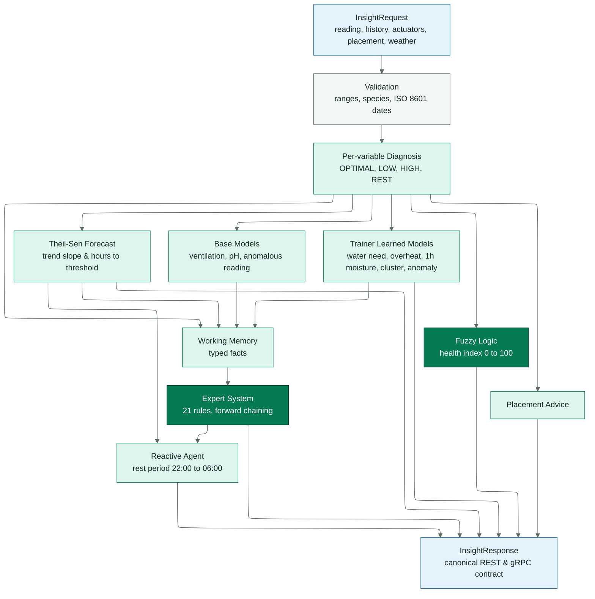
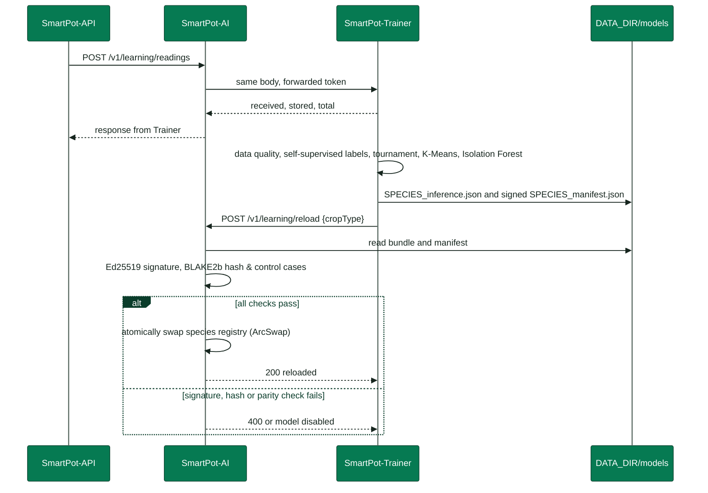
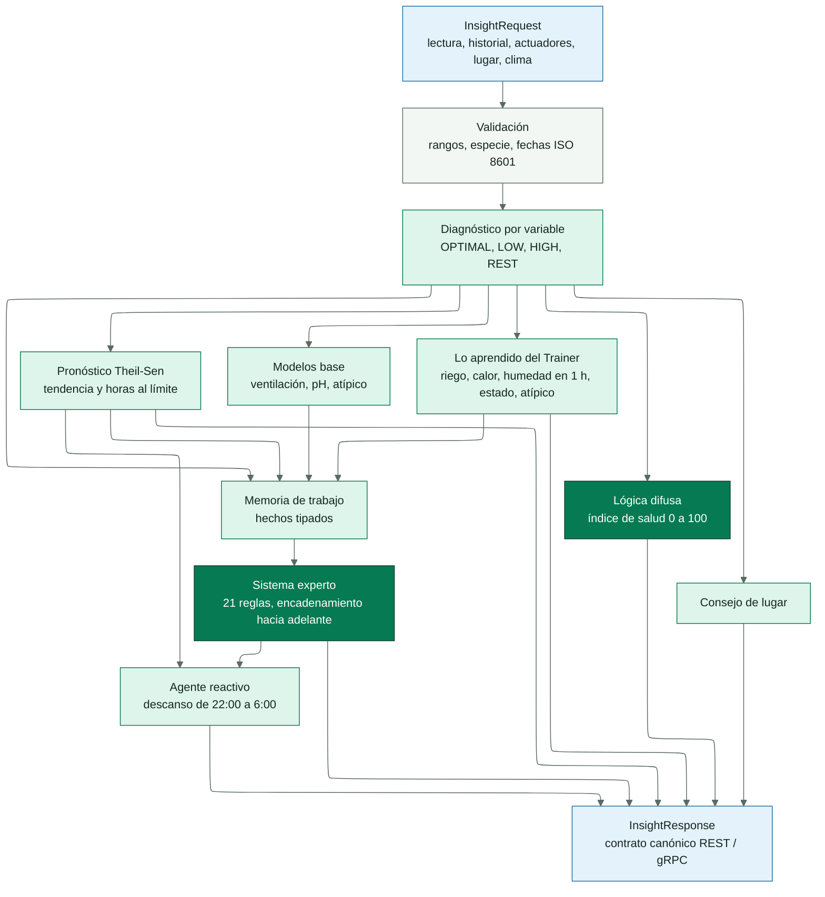
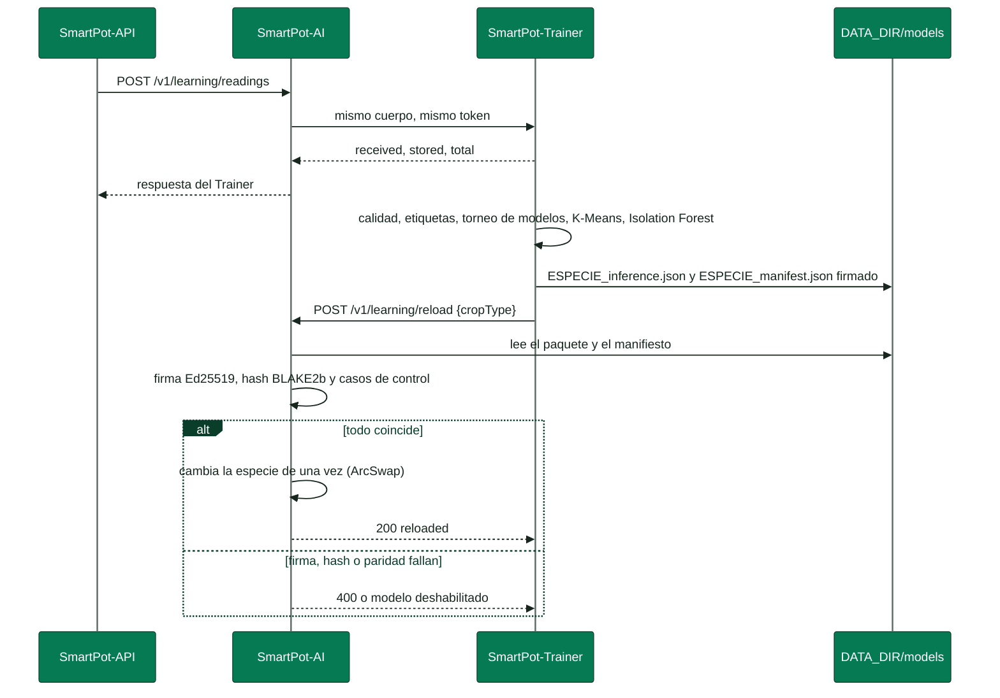

# SmartPot-AI

[English](#english) | [Español](#español)

---

## English

### Document Summary

| Field | Value |
| --- | --- |
| Project | SmartPot · [smartpot.app](https://smartpot.app) |
| Component | [SmartPot-AI](https://github.com/SmartPotTech/SmartPot-AI) |
| Version | 2.0.0 · November 2026 |
| Language & Runtime | Rust 1.88+ (2021 edition) · Tokio · Axum 0.8 · Tonic 0.14 · zero `unsafe` |
| Scope | Architecture, evaluation reasoning flow, parity verification, base & learned models, REST & gRPC contract, security, testing, and operations |
| Status | Canonical production inference service (Stack B). Legacy Python service archived in SmartPot-AI-Python |

---

### 1. Purpose

#### In Simple Terms

SmartPot-AI is the **reasoning and agronomic inference engine** in SmartPot production: the API sends the latest telemetry for a crop, and the AI returns its health condition, active stress factors, forecasts for upcoming hours, and recommended actions. It does not train models: it uses models trained by [SmartPot-Trainer](https://github.com/SmartPotTech/SmartPot-Trainer) along with base models embedded directly inside the binary.

It replaces the legacy Python service ([SmartPot-AI-Python](https://github.com/SmartPotTech/SmartPot-AI-Python)) in production: identical routes, fields, status codes, and standardized error and diagnostic output.

| Component | Legacy Stack A (Deprecated) | Production Stack B (Canonical) |
| --- | --- | --- |
| Inference | SmartPot-AI-Python (FastAPI, scikit-learn) | **SmartPot-AI** (Rust 1.88+, Axum, Tonic) |
| Training | Inside SmartPot-AI (SQLite) | SmartPot-Trainer (Python, TimescaleDB, Ed25519) |
| API Transport | REST | REST or gRPC (UNIX socket or TCP) |
| Learned Models | `joblib` (pickle) | Native JSON signed with Ed25519 |

### 2. Architecture

```mermaid
%%{init: {"theme": "base", "fontFamily": "Segoe UI, Arial, sans-serif", "themeVariables": {"fontFamily": "Segoe UI, Arial, sans-serif", "fontSize": "15px", "primaryColor": "#DDF5EA", "primaryTextColor": "#17261F", "primaryBorderColor": "#067A52", "secondaryColor": "#E3F2FB", "secondaryTextColor": "#17261F", "secondaryBorderColor": "#1F6FA0", "tertiaryColor": "#F2F7F4", "tertiaryTextColor": "#17261F", "tertiaryBorderColor": "#D5E3DC", "lineColor": "#5B6B63", "textColor": "#17261F", "mainBkg": "#DDF5EA", "nodeBorder": "#067A52", "clusterBkg": "#F7FAF8", "clusterBorder": "#D5E3DC", "edgeLabelBackground": "#FFFFFF", "actorBkg": "#067A52", "actorBorder": "#0B3D2B", "actorTextColor": "#FFFFFF", "actorLineColor": "#5B6B63", "signalColor": "#17261F", "signalTextColor": "#17261F", "labelBoxBkgColor": "#0B3D2B", "labelBoxBorderColor": "#0B3D2B", "labelTextColor": "#FFFFFF", "loopTextColor": "#0B3D2B", "noteBkgColor": "#FDF4DD", "noteBorderColor": "#C98D12", "noteTextColor": "#17261F", "activationBkgColor": "#DDF5EA", "activationBorderColor": "#067A52", "attributeBackgroundColorOdd": "#FFFFFF", "attributeBackgroundColorEven": "#F2F7F4"}, "layout": "elk", "elk": {"nodePlacementStrategy": "BRANDES_KOEPF", "mergeEdges": false, "cycleBreakingStrategy": "GREEDY"}}}%%
flowchart LR
  api["SmartPot-API<br/>AI client"]
  trainer["SmartPot-Trainer<br/>Python training service"]
  shared[("Shared Volume<br/>DATA_DIR/models")]
  subgraph ia["SmartPot-AI · Rust 1.88+ / Tokio"]
    direction TB
    rest["http.rs · Axum :8000<br/>REST, constant-time token check"]
    grpc["grpc.rs · Tonic<br/>UNIX socket & TCP, same JSON"]
    services["services · insights & fleet<br/>contract validation"]
    engine["engine · diagnosis, fuzzy, Theil-Sen,<br/>21 rules, agent, placement, fleet"]
    base["engine/models.rs<br/>embedded base models"]
    learned["learning · ArcSwap registry<br/>Ed25519 + BLAKE2b + control cases"]
    proxy["learning/trainer.rs<br/>reverse proxy & cached counts"]
  end
  api -->|"REST HTTP/1.x"| rest
  api -->|"gRPC HTTP/2"| grpc
  rest & grpc --> services
  services --> engine
  engine --> base
  services --> learned
  rest -->|"/v1/learning/*"| proxy
  proxy -->|"HTTP + token"| trainer
  trainer -->|"writes & signs"| shared
  trainer -->|"POST /v1/learning/reload"| rest
  shared -->|"read-only"| learned
  classDef leaf fill:#DDF5EA,stroke:#067A52,color:#17261F
  classDef water fill:#E3F2FB,stroke:#1F6FA0,color:#17261F
  classDef sun fill:#FDF4DD,stroke:#C98D12,color:#17261F
  classDef clay fill:#FBE9E1,stroke:#B85A38,color:#17261F
  classDef core fill:#067A52,stroke:#0B3D2B,color:#FFFFFF
  classDef muted fill:#F2F7F4,stroke:#5B6B63,color:#17261F
  class api,trainer water
  class shared muted
  class rest,grpc sun
  class services core
  class engine,base,learned,proxy leaf
```

<!-- diagrama: SmartPot_IA_Rust_Global_Component | titulo=SmartPot-IA-Rust Components -->

| Module | Responsibility |
| --- | --- |
| `schema` | Request validation (camelCase or snake_case, physical ranges, crop types, ISO 8601 timestamps) and response shapes |
| `domain` | Agronomic profiles for the six supported species and lighting requirements |
| `engine` | Diagnosis, fuzzy logic, Theil-Sen regression, expert system, reactive agent, placement advice, base models, and fleet analysis |
| `ml` | Native evaluation of scikit-learn models, K-Means clustering, and LoRA adapters |
| `learning` | Trainer bundles, verification, hot reloading, live telemetry counters, and proxy |
| `http`, `grpc` | Transport layers; both call the same core use cases (`services`) |

REST and gRPC share application state (`AppState`): configuration, base models, and the learned model registry. Evaluations read an immutable snapshot of the registry; reloads assemble a new snapshot and publish it atomically (`ArcSwap`), without blocking concurrent evaluations.

### 3. Inference Reasoning Pipeline

<!-- diagrama: SmartPot_IA_Rust_01_Insight_Pipeline | titulo=From Reading to Diagnostic Response -->

1. **Per-variable diagnosis.** Each sensor reading is evaluated against the species ideal range: `OPTIMAL`, `LOW`, or `HIGH`, with severity `WARNING` or `CRITICAL` based on deviation tolerances. Low light between 22:00 and 06:00 is classified as `REST`.
2. **Forecasting.** Given at least six readings spanning 18+ minutes, Theil-Sen regression computes slopes for temperature, humidity, pH, TDS, and substrate moisture. The median slope is identified via `select_nth_unstable_by` in O(M) without full sorting. If the projected trend exits bounds within 24 hours, hours-to-limit is estimated.
3. **Base models.** Logistic regression (ventilation probability), MLP neural network (pH correction probability), and Isolation Forest (anomalous reading score combined with sudden jump checks).
4. **Learned models.** When models have been trained by SmartPot-Trainer for the species: predictions for water need within 1 hour, overheating within 1 hour, projected moisture in 1 hour, operating cluster state, and anomaly scores.
5. **Expert system.** 21 rules operating over typed working memory facts. Each cycle fires the highest-salience unfired rule whose conditions are satisfied; conclusions asserted into working memory can trigger secondary rules. The firing trace produces user-facing explanations.
6. **Fuzzy logic.** Zero-order Sugeno health index: four trapezoidal membership sets per parameter deviation, agronomic weights, and a worst-case rule for critical deviations. Trapezoids are evaluated via branchless `max(0, min(up, 1, down))` operations.
7. **Reactive agent.** Proposes actuator actions; suppresses UV lighting at night (turns off lights if on), avoids outdoor watering when rain is detected, and requires ≥ 0.85 confidence for learned model actions. No actions are dispatched if sensor failure is suspected.
8. **Placement advice and summary.** Contextual relocation recommendation and localized diagnostic summary.

### 4. Parity with SmartPot-AI

The goal is exact numerical and behavioral parity. Tests evaluate test requests against the Python reference service: `tools/` generates test suites, sends them to SmartPot-AI, and records responses; `cargo test` asserts parity.

| Python Specifics | How Rust Replicates It |
| --- | --- |
| `round(x, n)` half-to-even on IEEE-754 floats | Format with `n` decimals (Rust rounds half-to-even) and parse back |
| `f"{x:.0%}"`, `f"{x:.1f}"`, `f"{n:,}"` | Dedicated formatting functions in `format.rs` tested against Python |
| Python 3.12+ `sum()` (Neumaier compensated summation) | `numeric::py_sum` in fuzzy logic evaluation |
| `np.sum`, `np.mean`, `np.std` (pairwise summation) | `numeric::pairwise_sum` with 8-element leaf blocks and recursive splitting |
| Scikit-learn decision trees over `float32` | Input vector cast to `f32` before comparing against split thresholds |
| `KMeans(n_init=10, random_state=42)` | MT19937 PRNG from `RandomState`, k-means++ seeding, centered data, and Lloyd iterations |

Test coverage with versioned fixtures: 418 evaluations (405 valid, 13 invalid verifying 422 codes and field paths), 156 fleet scenarios including K-Means cluster assignments, and 40 learned evaluations matching Python reference outputs; base models match scikit-learn to within ≤ 1e-12.

The parity fixture expected responses are regenerated in English via `SMARTPOT_REGENERATE_FIXTURES=1 cargo test --test regenerate -- --ignored` (`tests/regenerate.rs`), which fails if any non-textual data changes (status codes, numbers, JSON keys, list lengths, or enum codes).

### 5. Models

#### Base Models

`tools/export_base_models.py` trains the canonical SmartPot-AI models (seed 42) and serializes their parameters to `models/base_models.json` (scalers, coefficients, neural layers, and 150 Isolation Forest trees with leaf values). The file is embedded in the binary via `include_str!`: zero training latency and zero missing-model errors at startup. The script verifies that the exported forest matches scikit-learn outputs before saving.

#### Learned Models

<!-- diagrama: SmartPot_IA_Rust_02_Model_Reload | titulo=From Training to Hot Reloading -->

The Trainer writes `{SPECIES}_inference.json` (`smartpot.learned-models/1` schema) containing:

| Content | Format |
| --- | --- |
| Champion for each task | `Pipeline`: optional scaler and model (`logistic`, `linear`, `mlp`, `forest`, `hist_gradient_boosting`, `knn`, or `constant`) |
| Operational clusters | Scaler, K-Means cluster centers, and state descriptions |
| Anomalies | Isolation Forest with leaf depth values |
| LoRA | `W0`, `B`, `A`, biases, and update counters; effective weight `W = W0 + (α/r)·B·A` |
| Control cases | Exactly 16 valid input vectors (10 finite features) with scikit-learn reference predictions; a bundle with any missing, malformed or duplicated case is rejected |

along with `{SPECIES}_manifest.json` containing the 256-bit BLAKE2b hash of each file and the Ed25519 signature over canonical Python JSON (`sort_keys`, compact separators, escaped non-ASCII). Rust reconstructs the exact canonical bytes for verification.

During hot reload:

1. With `TRUSTED_MODEL_PUBLIC_KEY_HEX`: missing manifest, mismatched hash, or invalid signature causes bundle rejection (HTTP 400). Without a trusted key, file integrity is validated against the manifest.
2. `POST /v1/learning/reload` returns 400 with the `rejected` detail for a global reload too; `POST /v1/learning/readings` returns 503 when the Trainer is unavailable or stores nothing, so the API requeues the batch.
2. Every model is structurally validated (dimensions, finite floats, tree child indices strictly greater than node index to guarantee termination) and evaluated against control cases. Any model diverging from scikit-learn is disabled.
3. The species registry is updated atomically.

### 6. Contract and Transports

REST on `PORT` (8000): HTTP/1.0, HTTP/1.1, and HTTP/2 cleartext. `/health` is unauthenticated; all `/v1/*` endpoints require the service token verified via constant-time comparison (`subtle`).

gRPC: `smartpot.v1.SmartPotAIService` exposing `EvaluateInsight` and `AnalyzeFleet`. `JsonBody` carries the REST JSON payload directly, eliminating dual-schema drift and preserving distinctions between `0.0` and omitted sensors. An interceptor enforces `authorization: Bearer <token>` (`UNAUTHENTICATED` if missing or invalid); malformed payloads return `INVALID_ARGUMENT` with FastAPI-compatible validation details. UNIX domain socket paths are initialized with `0666` permissions for multi-container volume sharing; TCP binds to internal private networks.

Learning proxy: readings ingestion, status, training triggers, crop deletion, and pruning requests are forwarded to SmartPot-Trainer with authentication headers preserved. Payloads stream as raw bytes (timestamps preserved verbatim), and crop IDs are strictly validated to prevent path traversal. If Trainer is unreachable, safe fallback defaults are returned.

### 7. Security

| Control | Implementation Details |
| --- | --- |
| Memory safety | `#![deny(unsafe_code)]` enforced across library and binary |
| Authentication | 24+ character service token across REST and gRPC, verified in constant time |
| Model safety | Zero pickle deserialization: parameters parsed from validated JSON; Ed25519 (`verify_strict`) and BLAKE2b anti-tampering verification; 64 MB bundle and 1 MB manifest limits |
| Input validation | Physical range boundaries and array caps (500 history points, 50 fleet crops, 20 actuators); 4 MB body limit |
| Container isolation | Unprivileged user `10001`, compatible with `read_only`, `cap_drop: ALL`, and `no-new-privileges: true`; self-contained healthcheck binary |
| Dependencies | Automated `cargo audit`, Snyk, CodeQL, and Dependabot across cargo, Docker, and GitHub Actions |

### 8. Testing

Quality gates: `cargo fmt --all -- --check`, `cargo clippy --all-targets -- -D warnings`, and `cargo test`:

| Test Suite | Coverage |
| --- | --- |
| Unit tests | Formatting parity, NumPy/Python sum parity, profiles, diagnosis, night rest rules, fuzzy trapezoids, Theil-Sen regression vs complete sort, expert rules, reactive agent, placement rules, `f32` tree traversal, nearest neighbors, neural forward pass, K-Means MT19937 vs NumPy, LoRA adapter math, VPD, Kalman filter, canonical JSON encoding, BLAKE2b hashing, and configuration parsing |
| `parity` | Comprehensive insights, fleet analysis, catalog profiles, model metrics, and 401 status parity with SmartPot-AI |
| `learned` | Signed Trainer bundles: hot reload, inference parity with Python, hash/signature/missing manifest rejection, and control case disablement |
| `base_models` | Base models verified against scikit-learn reference predictions |
| `http_api` | Health status, authentication gates, 404/405 routing, zero vs missing sensor handling, offline Trainer fallbacks, and byte-for-byte forwarding |
| `grpc_api` | Exact response parity with REST, zero-reading preservation, token validation, error formats, and Linux UNIX domain sockets |

### 9. Operation

| Variable | Purpose |
| --- | --- |
| `SMARTPOT_AI_TOKEN` | Service authentication token (required) |
| `PORT`, `AI_GRPC_SOCKET`, `GRPC_TCP_PORT` | Transport listeners |
| `SMARTPOT_TRAINER_URL`, `SMARTPOT_TRAINER_TOKEN` | Trainer proxy configuration |
| `DATA_DIR`, `TRUSTED_MODEL_PUBLIC_KEY_HEX`, `AI_TIMEZONE` | Model repository directory, public signing key, and IANA zone for deriving `localHour` |
| `LEARNING_MIN_SAMPLES`, `RUST_LOG` | Advisory sample count threshold and tracing filter |

In `demo-beta`, `ai-smartpot` runs `ghcr.io/smartpottech/smartpot-ia-rust`, sharing the models volume with Trainer (read-only) and the gRPC socket volume with the API. `/health` reports binary version, active learning mode, loaded species models, and whether cryptographic signatures are required.

---

## Español

### Ficha del documento

| Campo | Valor |
| --- | --- |
| Proyecto | SmartPot · [smartpot.app](https://smartpot.app) |
| Componente | [SmartPot-AI](https://github.com/SmartPotTech/SmartPot-AI) |
| Versión | 2.0.0 · noviembre 2026 |
| Lenguaje y runtime | Rust 1.88+ (edición 2021) · Tokio · Axum 0.8 · Tonic 0.14 · sin `unsafe` |
| Alcance | Arquitectura, razonamiento agronómico, paridad, modelos base y aprendidos, contrato REST y gRPC, seguridad, pruebas y operación |
| Estado | Servicio canónico de inferencia en producción (Stack B). Implementación histórica en Python archivada en SmartPot-AI-Python |

---

### 1. Propósito

#### En palabras simples

SmartPot-AI es la parte que **piensa** y razona agronómicamente en la producción de SmartPot: la API le manda la lectura de un cultivo y la IA le
devuelve cómo está la planta, qué la afecta, qué va a pasar en las próximas horas y qué hacer. No entrena: usa los
modelos que entrena [SmartPot-Trainer](https://github.com/SmartPotTech/SmartPot-Trainer) y los modelos base que vienen
dentro del binario.

Reemplaza a la implementación legada [SmartPot-AI-Python](https://github.com/SmartPotTech/SmartPot-AI-Python) en producción sin que la API ni la PWA
noten la diferencia: mismas rutas, mismos campos, mismos códigos y mismos textos estandarizados en inglés.

| Pieza | Stack A Legado (Deprecado) | Stack B Producción (Canónico) |
| --- | --- | --- |
| Inferencia | SmartPot-AI-Python (FastAPI, scikit-learn) | **SmartPot-AI** (Rust 1.88+, Tokio, Axum, Tonic) |
| Entrenamiento | Dentro de SmartPot-AI (SQLite) | SmartPot-Trainer (Python, TimescaleDB, Ed25519) |
| Transporte con la API | REST | REST o gRPC (socket UNIX o TCP) |
| Modelos aprendidos | `joblib` (pickle) | JSON nativo firmado con Ed25519 |

### 2. Arquitectura

```mermaid
%%{init: {"theme": "base", "fontFamily": "Segoe UI, Arial, sans-serif", "themeVariables": {"fontFamily": "Segoe UI, Arial, sans-serif", "fontSize": "15px", "primaryColor": "#DDF5EA", "primaryTextColor": "#17261F", "primaryBorderColor": "#067A52", "secondaryColor": "#E3F2FB", "secondaryTextColor": "#17261F", "secondaryBorderColor": "#1F6FA0", "tertiaryColor": "#F2F7F4", "tertiaryTextColor": "#17261F", "tertiaryBorderColor": "#D5E3DC", "lineColor": "#5B6B63", "textColor": "#17261F", "mainBkg": "#DDF5EA", "nodeBorder": "#067A52", "clusterBkg": "#F7FAF8", "clusterBorder": "#D5E3DC", "edgeLabelBackground": "#FFFFFF", "actorBkg": "#067A52", "actorBorder": "#0B3D2B", "actorTextColor": "#FFFFFF", "actorLineColor": "#5B6B63", "signalColor": "#17261F", "signalTextColor": "#17261F", "labelBoxBkgColor": "#0B3D2B", "labelBoxBorderColor": "#0B3D2B", "labelTextColor": "#FFFFFF", "loopTextColor": "#0B3D2B", "noteBkgColor": "#FDF4DD", "noteBorderColor": "#C98D12", "noteTextColor": "#17261F", "activationBkgColor": "#DDF5EA", "activationBorderColor": "#067A52", "attributeBackgroundColorOdd": "#FFFFFF", "attributeBackgroundColorEven": "#F2F7F4"}, "layout": "elk", "elk": {"nodePlacementStrategy": "BRANDES_KOEPF", "mergeEdges": false, "cycleBreakingStrategy": "GREEDY"}}}%%
flowchart LR
  api["SmartPot-API<br/>cliente de la IA"]
  trainer["SmartPot-Trainer<br/>entrenamiento en Python"]
  shared[("Volumen compartido<br/>DATA_DIR/models")]
  subgraph ia["SmartPot-AI · Rust 1.88+ / Tokio"]
    direction TB
    rest["http.rs · Axum :8000<br/>REST, token en tiempo constante"]
    grpc["grpc.rs · Tonic<br/>socket UNIX y TCP, mismo JSON"]
    services["services · insights y flota<br/>validación del contrato"]
    engine["engine · diagnóstico, difusa, Theil-Sen,<br/>21 reglas, agente, lugar, flota"]
    base["engine/models.rs<br/>modelos base dentro del binario"]
    learned["learning · registro ArcSwap<br/>Ed25519 + BLAKE2b + casos de control"]
    proxy["learning/trainer.rs<br/>proxy y conteos con caché"]
  end
  api -->|"REST HTTP/1.x"| rest
  api -->|"gRPC HTTP/2"| grpc
  rest & grpc --> services
  services --> engine
  engine --> base
  services --> learned
  rest -->|"/v1/learning/*"| proxy
  proxy -->|"HTTP + token"| trainer
  trainer -->|"escribe y firma"| shared
  trainer -->|"POST /v1/learning/reload"| rest
  shared -->|"solo lectura"| learned
  classDef leaf fill:#DDF5EA,stroke:#067A52,color:#17261F
  classDef water fill:#E3F2FB,stroke:#1F6FA0,color:#17261F
  classDef sun fill:#FDF4DD,stroke:#C98D12,color:#17261F
  classDef clay fill:#FBE9E1,stroke:#B85A38,color:#17261F
  classDef core fill:#067A52,stroke:#0B3D2B,color:#FFFFFF
  classDef muted fill:#F2F7F4,stroke:#5B6B63,color:#17261F
  class api,trainer water
  class shared muted
  class rest,grpc sun
  class services core
  class engine,base,learned,proxy leaf
```

<!-- diagrama: SmartPot_IA_Rust_Global_Component | titulo=Componentes de SmartPot-IA-Rust -->

| Módulo | Responsabilidad |
| --- | --- |
| `schema` | Validación de las peticiones (camelCase o snake_case, rangos físicos, especies, fechas ISO 8601) y forma de las respuestas |
| `domain` | Perfiles de las seis especies y necesidades de luz |
| `engine` | Diagnóstico, lógica difusa, Theil-Sen, sistema experto, agente, lugar, modelos base y flota |
| `ml` | Evaluación nativa de modelos de scikit-learn, K-Means y LoRA |
| `learning` | Paquetes del Trainer, verificación, recarga en caliente, variables en vivo y proxy |
| `http`, `grpc` | Transportes; ambos llaman a los mismos casos de uso (`services`) |

REST y gRPC comparten el estado (`AppState`): configuración, modelos base y registro de modelos aprendidos. Las
evaluaciones leen una instantánea inmutable del registro; la recarga construye una nueva y la publica de una vez
(`ArcSwap`), sin bloquear evaluaciones en curso.

### 3. Cómo razona una evaluación

<!-- diagrama: SmartPot_IA_Rust_01_Insight_Pipeline | titulo=De la lectura a la respuesta -->

1. **Diagnóstico por variable.** Cada valor se compara con el rango ideal de la especie: `OPTIMAL`, `LOW` o `HIGH`,
   con severidad `WARNING` o `CRITICAL` desde una tolerancia de desviación. De 22:00 a 6:00 la luz baja es `REST`.
2. **Pronóstico.** Con al menos seis lecturas en 18 minutos, Theil-Sen estima la pendiente de temperatura, humedad,
   pH, nutrientes y sustrato. La mediana de las pendientes se obtiene con `select_nth_unstable_by` (O(M) sobre las
   M pendientes, sin ordenarlas). Si la tendencia saca la variable de su rango en menos de 24 h, informa en cuánto.
3. **Modelos base.** Regresión logística (ventilación), red MLP (corrección de pH) e Isolation Forest (lectura
   atípica, combinada con saltos bruscos frente al historial).
4. **Lo aprendido.** Si el Trainer ya entrenó la especie: probabilidad de que el sustrato se seque o la temperatura
   pase del máximo en la próxima hora, humedad del sustrato en 1 h, estado de operación y atipicidad.
5. **Sistema experto.** 21 reglas sobre una memoria de trabajo tipada. En cada ciclo se dispara la regla de mayor
   prioridad que se cumple y no se disparó antes (un conjunto de bits marca las disparadas); sus conclusiones pueden
   activar otras reglas. La traza es la explicación que ve el usuario.
6. **Lógica difusa.** Índice de salud Sugeno de orden cero: cuatro conjuntos trapezoidales por desviación, pesos
   agronómicos y una regla de peor caso por variable crítica. Los trapecios se evalúan como
   `max(0, min(subida, 1, bajada))`, sin ramas, con los mismos bits que la versión con condicionales.
7. **Agente.** Acciones sobre los actuadores que el cultivo tiene; nunca enciende la luz ultravioleta de noche (si hay
   luz, la apaga), no riega si llueve sobre un cultivo al aire libre y solo actúa por lo aprendido con probabilidad
   de 0,85 o más. Ante una posible falla de sensor no propone nada.
8. **Consejo de lugar** y **resumen** diagnóstico contextual.

### 4. Paridad con SmartPot-AI

El objetivo es que la respuesta sea la misma, no parecida. Las pruebas usan al servicio en Python como oráculo:
`tools/` genera peticiones, las envía a SmartPot-AI y guarda sus respuestas; `cargo test` exige respuestas iguales.

| Detalle de Python | Cómo se replica |
| --- | --- |
| `round(x, n)` con mitad al par sobre el valor binario | Formatear con `n` decimales (Rust redondea igual) y volver a leer |
| `f"{x:.0%}"`, `f"{x:.1f}"` y `f"{n:,}"` | Funciones de `format.rs` con pruebas contra Python |
| `sum()` de Python 3.12+ (suma compensada de Neumaier) | `numeric::py_sum` en la lógica difusa |
| `np.sum`, `np.mean`, `np.std` (suma por pares) | `numeric::pairwise_sum` con bloques de 8 y división recursiva |
| Árboles de scikit-learn sobre `float32` | La entrada se convierte a `f32` antes de comparar con el umbral |
| `KMeans(n_init=10, random_state=42)` | MT19937 de `RandomState`, k-means++ de scikit-learn, datos centrados y Lloyd con sus fórmulas |

Resultados con los casos versionados: 418 evaluaciones (405 válidas, con 13 inválidas que deben dar el mismo 422 y
los mismos campos con error), 156 flotas con sus grupos y 40 evaluaciones con modelos del Trainer, todas iguales a las
de Python; los modelos base coinciden con scikit-learn con diferencias de 1e-12 o menos.

Los textos esperados de los casos de paridad se regeneran en inglés mediante `SMARTPOT_REGENERATE_FIXTURES=1 cargo test --test regenerate -- --ignored` (`tests/regenerate.rs`), garantizando que no cambie ningún código de estado, número, clave JSON, tamaño de lista ni código enum.

### 5. Modelos

#### Modelos base

`tools/export_base_models.py` entrena exactamente los modelos de SmartPot-AI (semilla 42) y guarda sus parámetros en
`models/base_models.json` (escalado, coeficientes, capas y los 150 árboles del Isolation Forest con el valor de cada
hoja). El archivo queda dentro del binario: no hay entrenamiento al arrancar ni archivos que falten. Antes de
escribirlo, el script comprueba que el bosque exportado da lo mismo que scikit-learn.

#### Modelos aprendidos

<!-- diagrama: SmartPot_IA_Rust_02_Model_Reload | titulo=Del entrenamiento a la recarga -->

El Trainer escribe `{ESPECIE}_inference.json` (formato `smartpot.learned-models/1`) con:

| Contenido | Formato |
| --- | --- |
| Campeón de cada tarea | `Pipeline`: escalado opcional y modelo `logistic`, `linear`, `mlp`, `forest`, `hist_gradient_boosting`, `knn` o `constant` |
| Estados de operación | Escalado, centros de K-Means y descripción de cada estado |
| Atípicos | Isolation Forest con el valor de cada hoja |
| LoRA | `W0`, `B`, `A`, sesgos y actualizaciones; peso efectivo `W = W0 + (α/r)·B·A` |
| Casos de control | Exactamente 16 filas válidas (10 features finitas) con lo que respondió scikit-learn; un bundle con casos faltantes, mal formados o duplicados se rechaza |

y `{ESPECIE}_manifest.json` con el hash BLAKE2b (256 bits) de cada archivo y la firma Ed25519 del JSON canónico de
Python (`sort_keys`, sin espacios, caracteres no ASCII escapados). La IA reconstruye esos bytes exactos para verificar.

Al recargar:

1. Con `TRUSTED_MODEL_PUBLIC_KEY_HEX`: sin manifiesto, con un hash distinto o con una firma de otra clave, el paquete
   se rechaza (y `POST /v1/learning/reload` responde 400, también en la recarga global). Sin clave de confianza se
   comprueba el hash si hay manifiesto, porque la clave que trae el propio manifiesto no prueba nada. Las lecturas
   devuelven 503 si el Trainer no responde o no guarda nada, para que la API reencole el lote.
2. Cada modelo se valida (dimensiones, valores finitos, árboles cuyos hijos están después de su padre, así recorrerlos
   siempre termina) y se evalúa con los casos de control. Un modelo que no coincide con scikit-learn se deshabilita y
   la evaluación sigue sin él.
3. La especie se reemplaza de una vez.

### 6. Contrato y transporte

REST en `PORT` (8000): HTTP/1.0, HTTP/1.1 y HTTP/2 sin TLS, así pasa por cualquier nginx. `/health` es público; el
resto exige el token de servicio, comparado en tiempo constante (`subtle`). Las rutas, campos y textos están en el
README.

gRPC: `smartpot.v1.SmartPotAIService` con `EvaluateInsight` y `AnalyzeFleet`. El mensaje `JsonBody` transporta el
mismo JSON de REST, de modo que no hay un segundo esquema que se desincronice y un `0.0` nunca se confunde con un
sensor ausente. Un interceptor exige `authorization: Bearer <token>` (`UNAUTHENTICATED` si falta); un cuerpo
inválido responde `INVALID_ARGUMENT` con el mismo detalle que el 422. Por socket UNIX, el archivo se recrea al
arrancar con permisos 0666 para los contenedores que comparten el volumen; por TCP, solo en la red interna.

Proxy de aprendizaje: lecturas, estado, entrenamiento, olvido y poda se reenvían a SmartPot-Trainer con su token. El
cuerpo viaja como bytes (las fechas no se reinterpretan) y los ids de cultivo solo admiten letras, dígitos, `-` y `_`,
así no pueden cambiar la ruta que se pide al Trainer. Si el Trainer no responde, la IA devuelve un estado seguro en
vez de un error.

### 7. Seguridad

| Control | Detalle |
| --- | --- |
| Memoria | `#![deny(unsafe_code)]` en la biblioteca y el binario |
| Autenticación | Token de al menos 24 caracteres en REST y gRPC, comparación en tiempo constante |
| Modelos | Sin pickle: solo parámetros en JSON validados; firma Ed25519 (`verify_strict`) y BLAKE2b; topes de 64 MB para el bundle y 1 MB para el manifiesto |
| Entradas | Validación de rangos y tamaños como en Python (500 lecturas de historial, 50 cultivos, 20 actuadores); cuerpos de hasta 4 MB |
| Contenedor | Usuario 10001 sin privilegios, compatible con `read_only`, `cap_drop: ALL` y `no-new-privileges`; sonda de salud sin `curl` |
| Dependencias | `cargo audit` en el CI (SARIF a la pestaña de seguridad), Snyk, CodeQL, revisión de dependencias y Dependabot (cargo, Docker y Actions) |

### 8. Pruebas

`cargo fmt --all -- --check`, `cargo clippy --all-targets -- -D warnings` y `cargo test`:

| Grupo | Qué comprueba |
| --- | --- |
| Unitarias | Formato como Python, sumas de NumPy y de Python, perfiles, diagnóstico y descanso nocturno, trapecios, Theil-Sen frente a la mediana con orden completo, reglas, agente, lugar, árboles en `f32`, vecinos, red neuronal, K-Means y MT19937 contra NumPy, LoRA, VPD, filtro de Kalman, JSON canónico, BLAKE2b y configuración |
| `parity` | Evaluaciones, flotas, catálogo, métricas y 401 iguales a SmartPot-AI |
| `learned` | Paquete firmado del Trainer: carga, respuestas iguales a Python, rechazo por hash, firma o falta de manifiesto y deshabilitado por casos de control |
| `base_models` | Modelos base frente a scikit-learn |
| `http_api` | Salud, autenticación, 404 y 405, perfiles, ceros frente a ausentes, estado sin Trainer, proxy byte a byte y Trainer caído |
| `grpc_api` | Misma respuesta que REST y que Python, ceros, token y errores; socket UNIX en Linux |

### 9. Operación

| Variable | Uso |
| --- | --- |
| `SMARTPOT_AI_TOKEN` | Token de servicio (obligatorio) |
| `PORT`, `AI_GRPC_SOCKET`, `GRPC_TCP_PORT` | Transportes |
| `SMARTPOT_TRAINER_URL`, `SMARTPOT_TRAINER_TOKEN` | Proxy de aprendizaje |
| `DATA_DIR`, `TRUSTED_MODEL_PUBLIC_KEY_HEX`, `AI_TIMEZONE` | Modelos aprendidos, su clave de confianza y la zona IANA para derivar `localHour` |
| `LEARNING_MIN_SAMPLES`, `RUST_LOG` | Mensaje de aprendizaje y nivel de registro |

En `demo-beta` el servicio `ai-smartpot` usa `ghcr.io/smartpottech/smartpot-ia-rust`, comparte con el Trainer el
volumen de modelos (montado en solo lectura) y con la API el volumen del socket gRPC. `/health` informa la versión, si
el aprendizaje está delegado en el Trainer, las especies con modelos cargados y si se exige firma.
