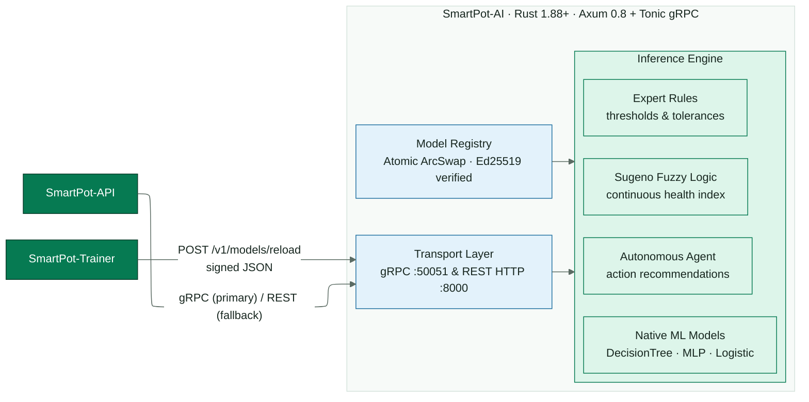
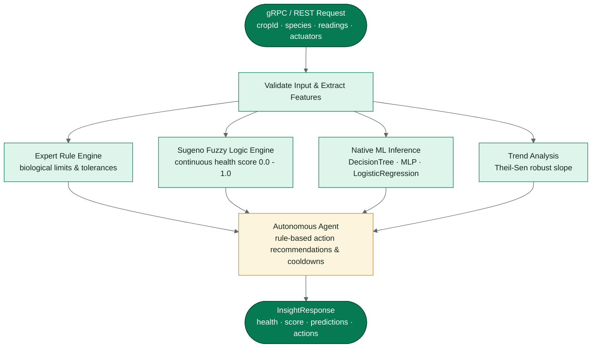
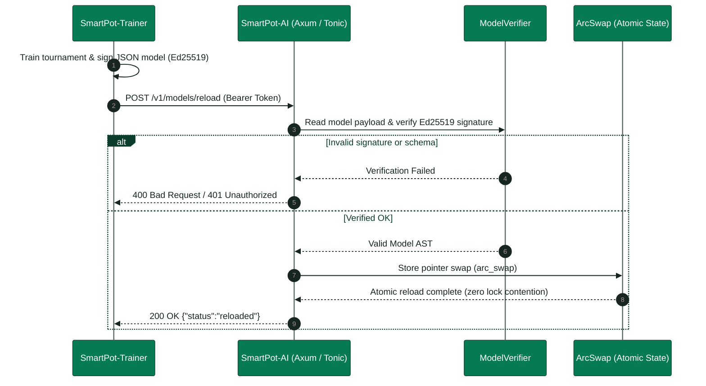

<!-- portada
eyebrow: Component Technical Documentation
titulo: SmartPot-AI
acento: AI
subtitulo: High-Performance Agronomic Inference Engine
bajada: High-performance Rust inference service: expert agronomic evaluation, fuzzy logic engines, neural inference, multi-crop fleet telemetry analysis, and gRPC/REST contracts.
documento: SmartPot-AI Documentation
version: 2.0 · November 2026
equipo: SmartPotTech
proyecto: smartpot.app
-->

# SmartPot-AI

---

### Document Summary

| Field | Value |
| --- | --- |
| Project | SmartPot · [smartpot.app](https://smartpot.app) |
| Component | [SmartPot-AI](https://github.com/SmartPotTech/SmartPot-AI) |
| Version | 2.0.0 · November 2026 |
| Language & Runtime | Rust 1.88+ (2021 edition) · Tokio · Axum 0.8 · Tonic 0.14 · zero `unsafe` |
| Scope | Architecture, evaluation reasoning flow, parity verification, base & learned models, REST & gRPC contract, security, testing, and operations |
| Status | Canonical production inference service (Stack B). Legacy Python service archived in SmartPot-AI-Python |

---

### 1. Purpose

#### In Simple Terms

SmartPot-AI is the **reasoning and agronomic inference engine** in SmartPot production: the API sends the latest telemetry for a crop, and the AI returns its health condition, active stress factors, forecasts for upcoming hours, and recommended actions. It does not train models: it uses models trained by [SmartPot-Trainer](https://github.com/SmartPotTech/SmartPot-Trainer) along with base models embedded directly inside the binary.

It replaces the legacy Python service ([SmartPot-AI-Python](https://github.com/SmartPotTech/SmartPot-AI-Python)) in production: identical routes, fields, status codes, and standardized error and diagnostic output.

| Component | Legacy Stack A (Deprecated) | Production Stack B (Canonical) |
| --- | --- | --- |
| Inference | SmartPot-AI-Python (FastAPI, scikit-learn) | **SmartPot-AI** (Rust 1.88+, Axum, Tonic) |
| Training | Inside SmartPot-AI (SQLite) | SmartPot-Trainer (Python, TimescaleDB, Ed25519) |
| API Transport | REST | REST or gRPC (UNIX socket or TCP) |
| Learned Models | `joblib` (pickle) | Native JSON signed with Ed25519 |

### 2. Architecture

<!-- diagrama: SmartPot_IA_Rust_Global_Component | titulo=SmartPot-IA-Rust Components -->

| Module | Responsibility |
| --- | --- |
| `schema` | Request validation (camelCase or snake_case, physical ranges, crop types, ISO 8601 timestamps) and response shapes |
| `domain` | Agronomic profiles for the six supported species and lighting requirements |
| `engine` | Diagnosis, fuzzy logic, Theil-Sen regression, expert system, reactive agent, placement advice, base models, and fleet analysis |
| `ml` | Native evaluation of scikit-learn models, K-Means clustering, and LoRA adapters |
| `learning` | Trainer bundles, verification, hot reloading, live telemetry counters, and proxy |
| `http`, `grpc` | Transport layers; both call the same core use cases (`services`) |

REST and gRPC share application state (`AppState`): configuration, base models, and the learned model registry. Evaluations read an immutable snapshot of the registry; reloads assemble a new snapshot and publish it atomically (`ArcSwap`), without blocking concurrent evaluations.

### 3. Inference Reasoning Pipeline

<!-- diagrama: SmartPot_IA_Rust_01_Insight_Pipeline | titulo=From Reading to Diagnostic Response -->

1. **Per-variable diagnosis.** Each sensor reading is evaluated against the species ideal range: `OPTIMAL`, `LOW`, or `HIGH`, with severity `WARNING` or `CRITICAL` based on deviation tolerances. Low light between 22:00 and 06:00 is classified as `REST`.
2. **Forecasting.** Given at least six readings spanning 18+ minutes, Theil-Sen regression computes slopes for temperature, humidity, pH, TDS, and substrate moisture. The median slope is identified via `select_nth_unstable_by` in O(M) without full sorting. If the projected trend exits bounds within 24 hours, hours-to-limit is estimated.
3. **Base models.** Logistic regression (ventilation probability), MLP neural network (pH correction probability), and Isolation Forest (anomalous reading score combined with sudden jump checks).
4. **Learned models.** When models have been trained by SmartPot-Trainer for the species: predictions for water need within 1 hour, overheating within 1 hour, projected moisture in 1 hour, operating cluster state, and anomaly scores.
5. **Expert system.** 21 rules operating over typed working memory facts. Each cycle fires the highest-salience unfired rule whose conditions are satisfied; conclusions asserted into working memory can trigger secondary rules. The firing trace produces user-facing explanations.
6. **Fuzzy logic.** Zero-order Sugeno health index: four trapezoidal membership sets per parameter deviation, agronomic weights, and a worst-case rule for critical deviations. Trapezoids are evaluated via branchless `max(0, min(up, 1, down))` operations.
7. **Reactive agent.** Proposes actuator actions; suppresses UV lighting at night (turns off lights if on), avoids outdoor watering when rain is detected, and requires ≥ 0.85 confidence for learned model actions. No actions are dispatched if sensor failure is suspected.
8. **Placement advice and summary.** Contextual relocation recommendation and localized diagnostic summary.

### 4. Parity with SmartPot-AI

The goal is exact numerical and behavioral parity. Tests evaluate test requests against the Python reference service: `tools/` generates test suites, sends them to SmartPot-AI, and records responses; `cargo test` asserts parity.

| Python Specifics | How Rust Replicates It |
| --- | --- |
| `round(x, n)` half-to-even on IEEE-754 floats | Format with `n` decimals (Rust rounds half-to-even) and parse back |
| `f"{x:.0%}"`, `f"{x:.1f}"`, `f"{n:,}"` | Dedicated formatting functions in `format.rs` tested against Python |
| Python 3.12+ `sum()` (Neumaier compensated summation) | `numeric::py_sum` in fuzzy logic evaluation |
| `np.sum`, `np.mean`, `np.std` (pairwise summation) | `numeric::pairwise_sum` with 8-element leaf blocks and recursive splitting |
| Scikit-learn decision trees over `float32` | Input vector cast to `f32` before comparing against split thresholds |
| `KMeans(n_init=10, random_state=42)` | MT19937 PRNG from `RandomState`, k-means++ seeding, centered data, and Lloyd iterations |

Test coverage with versioned fixtures: 418 evaluations (405 valid, 13 invalid verifying 422 codes and field paths), 156 fleet scenarios including K-Means cluster assignments, and 40 learned evaluations matching Python reference outputs; base models match scikit-learn to within ≤ 1e-12.

The parity fixture expected responses are regenerated in English via `SMARTPOT_REGENERATE_FIXTURES=1 cargo test --test regenerate -- --ignored` (`tests/regenerate.rs`), which fails if any non-textual data changes (status codes, numbers, JSON keys, list lengths, or enum codes).

### 5. Models

#### Base Models

`tools/export_base_models.py` trains the canonical SmartPot-AI models (seed 42) and serializes their parameters to `models/base_models.json` (scalers, coefficients, neural layers, and 150 Isolation Forest trees with leaf values). The file is embedded in the binary via `include_str!`: zero training latency and zero missing-model errors at startup. The script verifies that the exported forest matches scikit-learn outputs before saving.

#### Learned Models

<!-- diagrama: SmartPot_IA_Rust_02_Model_Reload | titulo=From Training to Hot Reloading -->

The Trainer writes `{SPECIES}_inference.json` (`smartpot.learned-models/1` schema) containing:

| Content | Format |
| --- | --- |
| Champion for each task | `Pipeline`: optional scaler and model (`logistic`, `linear`, `mlp`, `forest`, `hist_gradient_boosting`, `knn`, or `constant`) |
| Operational clusters | Scaler, K-Means cluster centers, and state descriptions |
| Anomalies | Isolation Forest with leaf depth values |
| LoRA | `W0`, `B`, `A`, biases, and update counters; effective weight `W = W0 + (α/r)·B·A` |
| Control cases | Exactly 16 valid input vectors (10 finite features) with scikit-learn reference predictions; a bundle with any missing, malformed or duplicated case is rejected |

along with `{SPECIES}_manifest.json` containing the 256-bit BLAKE2b hash of each file and the Ed25519 signature over canonical Python JSON (`sort_keys`, compact separators, escaped non-ASCII). Rust reconstructs the exact canonical bytes for verification.

During hot reload:

1. With `TRUSTED_MODEL_PUBLIC_KEY_HEX`: missing manifest, mismatched hash, or invalid signature causes bundle rejection (HTTP 400). Without a trusted key, file integrity is validated against the manifest.
2. `POST /v1/learning/reload` returns 400 with the `rejected` detail for a global reload too; `POST /v1/learning/readings` returns 503 when the Trainer is unavailable or stores nothing, so the API requeues the batch.
2. Every model is structurally validated (dimensions, finite floats, tree child indices strictly greater than node index to guarantee termination) and evaluated against control cases. Any model diverging from scikit-learn is disabled.
3. The species registry is updated atomically.

### 6. Contract and Transports

REST on `PORT` (8000): HTTP/1.0, HTTP/1.1, and HTTP/2 cleartext. `/health` is unauthenticated; all `/v1/*` endpoints require the service token verified via constant-time comparison (`subtle`).

gRPC: `smartpot.v1.SmartPotAIService` exposing `EvaluateInsight` and `AnalyzeFleet`. `JsonBody` carries the REST JSON payload directly, eliminating dual-schema drift and preserving distinctions between `0.0` and omitted sensors. An interceptor enforces `authorization: Bearer <token>` (`UNAUTHENTICATED` if missing or invalid); malformed payloads return `INVALID_ARGUMENT` with FastAPI-compatible validation details. UNIX domain socket paths are initialized with `0666` permissions for multi-container volume sharing; TCP binds to internal private networks.

Learning proxy: readings ingestion, status, training triggers, crop deletion, and pruning requests are forwarded to SmartPot-Trainer with authentication headers preserved. Payloads stream as raw bytes (timestamps preserved verbatim), and crop IDs are strictly validated to prevent path traversal. If Trainer is unreachable, safe fallback defaults are returned.

### 7. Security

| Control | Implementation Details |
| --- | --- |
| Memory safety | `#![deny(unsafe_code)]` enforced across library and binary |
| Authentication | 24+ character service token across REST and gRPC, verified in constant time |
| Model safety | Zero pickle deserialization: parameters parsed from validated JSON; Ed25519 (`verify_strict`) and BLAKE2b anti-tampering verification; 64 MB bundle and 1 MB manifest limits |
| Input validation | Physical range boundaries and array caps (500 history points, 50 fleet crops, 20 actuators); 4 MB body limit |
| Container isolation | Unprivileged user `10001`, compatible with `read_only`, `cap_drop: ALL`, and `no-new-privileges: true`; self-contained healthcheck binary |
| Dependencies | Automated `cargo audit`, Snyk, CodeQL, and Dependabot across cargo, Docker, and GitHub Actions |

### 8. Testing

Quality gates: `cargo fmt --all -- --check`, `cargo clippy --all-targets -- -D warnings`, and `cargo test`:

| Test Suite | Coverage |
| --- | --- |
| Unit tests | Formatting parity, NumPy/Python sum parity, profiles, diagnosis, night rest rules, fuzzy trapezoids, Theil-Sen regression vs complete sort, expert rules, reactive agent, placement rules, `f32` tree traversal, nearest neighbors, neural forward pass, K-Means MT19937 vs NumPy, LoRA adapter math, VPD, Kalman filter, canonical JSON encoding, BLAKE2b hashing, and configuration parsing |
| `parity` | Comprehensive insights, fleet analysis, catalog profiles, model metrics, and 401 status parity with SmartPot-AI |
| `learned` | Signed Trainer bundles: hot reload, inference parity with Python, hash/signature/missing manifest rejection, and control case disablement |
| `base_models` | Base models verified against scikit-learn reference predictions |
| `http_api` | Health status, authentication gates, 404/405 routing, zero vs missing sensor handling, offline Trainer fallbacks, and byte-for-byte forwarding |
| `grpc_api` | Exact response parity with REST, zero-reading preservation, token validation, error formats, and Linux UNIX domain sockets |

### 9. Operation

| Variable | Purpose |
| --- | --- |
| `SMARTPOT_AI_TOKEN` | Service authentication token (required) |
| `PORT`, `AI_GRPC_SOCKET`, `GRPC_TCP_PORT` | Transport listeners |
| `SMARTPOT_TRAINER_URL`, `SMARTPOT_TRAINER_TOKEN` | Trainer proxy configuration |
| `DATA_DIR`, `TRUSTED_MODEL_PUBLIC_KEY_HEX`, `AI_TIMEZONE` | Model repository directory, public signing key, and IANA zone for deriving `localHour` |
| `LEARNING_MIN_SAMPLES`, `RUST_LOG` | Advisory sample count threshold and tracing filter |

In `demo-beta`, `ai-smartpot` runs `ghcr.io/smartpottech/smartpot-ia-rust`, sharing the models volume with Trainer (read-only) and the gRPC socket volume with the API. `/health` reports binary version, active learning mode, loaded species models, and whether cryptographic signatures are required.

---

