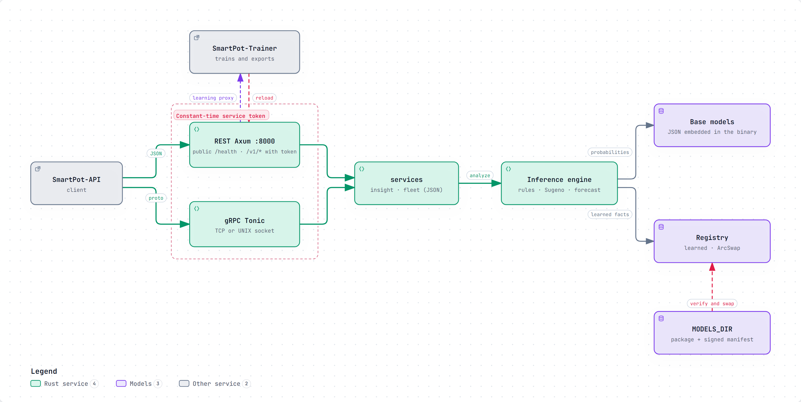

# SmartPot-AI · Interactive Diagrams

[English](#english) | [Español](#español)

---

## English

Each diagram is a self-contained HTML page that works offline. Download it and open it in a browser to zoom, search nodes, trace a path and jump to the exact source lines on GitHub. The PNG preview is the light-theme render of the same diagram.

### 1. SmartPot-AI: Transports and Models

How a request reaches the inference engine and where its models come from. SmartPot-API can call the Axum REST server on port 8000 or the Tonic gRPC server (TCP and, on Unix, a UNIX socket); both check the service token in constant time and hand the same JSON to `services`, which runs the engine (rules, Sugeno fuzzy logic and forecast). The engine combines the base models embedded in the binary with the learned models held by the `Registry`, an immutable `ArcSwap` snapshot that is replaced only after `MODELS_DIR` passes the Ed25519 signature and BLAKE2b checks. Learning routes are proxied to SmartPot-Trainer, which calls back `reload` when it publishes a new package.

- Interactive: [English](SmartPot_AI_A1_Transports_And_Models.en.html) · [Spanish](SmartPot_AI_A1_Transports_And_Models.es.html)
- Sources: `src/http.rs`, `src/grpc.rs`, `src/auth.rs`, `src/main.rs`, `src/config.rs`, `src/services/`, `src/engine/models.rs` and `src/learning/` at commit `66a4f4d`.

---

## Español

Cada diagrama es una página HTML autocontenida que funciona sin conexión. Descárgala y ábrela en un navegador para ampliar, buscar nodos, seguir un recorrido y saltar a las líneas exactas del código en GitHub. La vista previa PNG es el mismo diagrama en tema claro.

### 1. SmartPot-AI: transportes y modelos

Cómo llega una petición al motor de inferencia y de dónde salen sus modelos. SmartPot-API puede llamar al servidor REST Axum en el puerto 8000 o al servidor gRPC Tonic (TCP y, en Unix, un socket UNIX); ambos validan el token de servicio en tiempo constante y entregan el mismo JSON a `services`, que ejecuta el motor (reglas, lógica difusa Sugeno y pronóstico). El motor combina los modelos base embebidos en el binario con los aprendidos que guarda el `Registry`, una instantánea inmutable `ArcSwap` que solo se reemplaza cuando `MODELS_DIR` supera la firma Ed25519 y los hashes BLAKE2b. Las rutas de aprendizaje se reenvían a SmartPot-Trainer, que llama a `reload` cuando publica un paquete nuevo.

- Interactivo: [inglés](SmartPot_AI_A1_Transports_And_Models.en.html) · [español](SmartPot_AI_A1_Transports_And_Models.es.html)
- Fuentes: `src/http.rs`, `src/grpc.rs`, `src/auth.rs`, `src/main.rs`, `src/config.rs`, `src/services/`, `src/engine/models.rs` y `src/learning/` en el commit `66a4f4d`.

